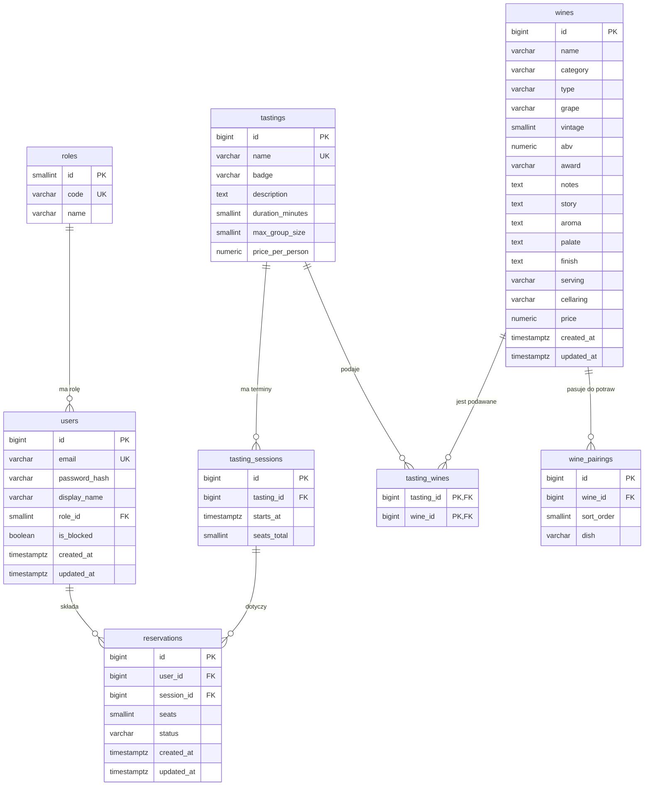

# VinoKeep

VinoKeep to aplikacja webowa dla winnic: prezentuje ofertę (wina, degustacje, historię posiadłości) i będzie służyć do zarządzania winnicą. Projekt na kurs „Wstęp do Projektowania Aplikacji Internetowych” (WdPAI), budowany w PHP w architekturze MVC. Domyślna treść jest przygotowana dla winnicy Corvo Bianco, ale wszystkie napisy są wydzielone do konfiguracji, żeby platforma działała dla dowolnej winnicy.

## Funkcje

| Obszar | Co robi | Status |
|---|---|---|
| Strona startowa (`/`) | Hero, statystyki winnicy, przyciski do głównych sekcji | gotowe |
| Nasze wina (`/wines`) | Katalog win w siatce kart, filtr rodzaju (`?type=`) i rozbudowana strona szczegółów wina (`/wines/{id}`: opis, notatki degustacyjne, potrawy, temperatura podawania, leżakowanie, karta z ceną i sekcja „Zobacz także”) | gotowe (dane z PostgreSQL) |
| Degustacje (`/tastings`) | Oferty degustacji z winami i najbliższymi terminami (wolne miejsca z widoku bazy), kroki rezerwacji oraz formularze rezerwacji i anulowania dla zalogowanych | gotowe, dane z bazy, rezerwacje przez Fetch API (wymagają JavaScriptu) |
| O winnicy (`/about`) | Historia, fakty i cechy posiadłości | gotowe |
| Logowanie (`/login`) | Uwierzytelnianie hasłem (`password_verify`), sesja z nowym id po zalogowaniu, jeden ogólny komunikat przy złym adresie lub haśle, token CSRF | gotowe |
| Rejestracja (`/register`) | Walidacja e-maila i hasła (długość, litera, cyfra, znak specjalny, powtórzenie), zapis konta gościa ze skrótem hasła (`password_hash`), obsługa zajętego adresu, wiadomość powitalna e-mailem (Lab 13) | gotowe |
| Wylogowanie (`POST /logout`) | Czyści sesję, wygasza ciasteczko i niszczy sesję; wymaga tokenu CSRF | gotowe |
| Konto (`/account`) | Dane zalogowanego użytkownika, jego rola i uprawnienia; bez logowania 401 | gotowe |
| Zarządzanie winami (`/wines/new`, `/wines/{id}/edit`) | Formularze dodawania i edycji z walidacją, usuwanie z potwierdzeniem; piwniczy dodaje i edytuje, administrator i właściciel dodatkowo usuwają | gotowe |
| Panel użytkowników (`/admin/users`) | Lista kont pobierana przez Fetch API (`GET /api/users`), blokowanie i odblokowywanie (`PATCH`), usuwanie (`DELETE`) oraz, dla właściciela, nadawanie roli administratora; stany wczytywania, pustej listy i błędów | gotowe (Lab 11) |
| Teksty serwisu | Wszystkie napisy i nazwa marki w `config/content.php` | gotowe |
| Motyw jasny/ciemny | Przełącznik w nagłówku: tryb systemowy, jasny lub ciemny, wybór zapamiętany w przeglądarce | gotowe |
| Dostępność (WCAG) | Semantyczne znaczniki, widoczny fokus, kontrast sprawdzony w obu motywach narzędziem axe | częściowo, pełny audyt planowany w przyszłości |
| Baza PostgreSQL | Schemat z 8 tabelami (użytkownicy, role, wina, degustacje, rezerwacje), indeksy, dane demonstracyjne i warstwa danych przez PDO (encje, repozytoria, DTO, Value Object) | gotowe, aplikacja czyta z bazy wina, degustacje i konta, a zapisuje konta oraz wina |
| Role użytkowników | `GUEST`, `CELLAR_MASTER`, `ADMIN` (może być ich wielu) i `WINERY_OWNER` (jeden, wymuszone indeksem w bazie) z uprawnieniami sprawdzanymi po stronie serwera (401 bez logowania, 403 przy niewłaściwej roli) | gotowe |
| Bezpieczeństwo (Lab 12) | HTTPS z przekierowaniem z HTTP, limit prób logowania (429 i `Retry-After`), dziennik nieudanych logowań bez haseł, singleton repozytorium użytkowników, błędy tylko w logu serwera; tabela dowodów dla wszystkich punktów A1–E5 w sekcji „Bezpieczeństwo (Lab 12)” | gotowe (Lab 12) |
| Rezerwacje degustacji | Zalogowany użytkownik rezerwuje i anuluje miejsca na `/tastings` bez przeładowania strony (`POST /api/reservations`, `DELETE /api/reservations/{id}`); liczbę wolnych miejsc zwraca widok bazy, a zapis działa w transakcji z blokadą terminu, więc nie da się sprzedać więcej miejsc, niż jest | gotowe (Lab 8 i 11) |
| E-mail po rejestracji (Lab 13) | Po założeniu konta aplikacja wysyła wiadomość powitalną przez SMTP (PHPMailer); lokalnie ląduje w Mailpit (http://localhost:8025). Awaria poczty nie cofa konta, użytkownik widzi tylko ostrzeżenie | gotowe (Lab 13) |
| Zdjęcia win (Lab 13) | Piwniczy dodaje, podmienia i usuwa zdjęcie butelki w formularzu wina; plik jest sprawdzany (rozmiar, prawdziwy typ MIME, rozszerzenie) i zapisywany pod losową nazwą, a w bazie jest tylko ścieżka | gotowe (Lab 13) |
| Zadanie CRON (Lab 13) | Co godzinę kontener `cron` wysyła gościom przypomnienie o degustacji, która zaczyna się w ciągu 24 godzin; zadanie zapisuje wynik w logu i jest bezpieczne przy powtórzeniu | gotowe (Lab 13) |
| Edycja treści | Edycja treści w panelu | planowane w przyszłości |

## Tech stack

| Warstwa | Technologie |
|---|---|
| Backend | PHP 8.3 (własny MVC, autoloading PSR-4 przez Composer) |
| Serwer HTTP | Nginx + PHP-FPM |
| Baza danych | PostgreSQL (kontener `db`), dostęp z PHP przez PDO i sterownik `pdo_pgsql` |
| Frontend | HTML (widoki PHP), jeden plik CSS (zmienne CSS, Flexbox, Grid, mobile-first), JavaScript bez bibliotek (przełącznik motywu, walidacja formularzy, Fetch API w panelu użytkowników) |
| Konteneryzacja | Docker Compose |
| Poczta | PHPMailer (SMTP), lokalnie Mailpit do podglądu wiadomości |
| Zadania cykliczne | `crond` (busybox) w osobnym kontenerze `cron`, skrypt `bin/send-tasting-reminders.php` |
| Narzędzia | Mailpit (podgląd maili), pgAdmin (zarządzanie bazą) |

## Szybki start

```bash
git clone https://github.com/LMrosz/WdPAI.git
cd my-app
cp .env.example .env
docker compose up --build -d
```

| Usługa | Adres |
|---|---|
| Aplikacja | https://localhost:8443 (http://localhost:8080 przekierowuje na HTTPS) |
| Mailpit | http://localhost:8025 |
| pgAdmin | http://localhost:5050 |

Aplikacja działa przez HTTPS z certyfikatem samopodpisanym, który powstaje przy budowie obrazu nginx (tylko do pracy lokalnej), więc przeglądarka pokaże ostrzeżenie: wybierz „Zaawansowane”, a potem „Przejdź do localhost”. Jeśli wolisz zwykłe HTTP, ustaw w `.env` `FORCE_HTTPS=0` i uruchom `docker compose up -d`; wtedy aplikacja działa pod `http://localhost:8080` (szczegóły w „Bezpieczeństwo (Lab 12)”).

Porty i dane dostępowe są w pliku `.env`, który powstaje z wzoru `.env.example` (sam `.env` jest w `.gitignore`): `POSTGRES_DB`, `POSTGRES_USER`, `POSTGRES_PASSWORD`, `POSTGRES_PORT`, `MAILPIT_PORT`, `MAIL_HOST`, `MAIL_PORT`, `MAIL_USERNAME`, `MAIL_PASSWORD`, `MAIL_ENCRYPTION`, `MAIL_FROM`, `MAIL_FROM_NAME`, `APP_URL`, `FORCE_HTTPS`, `HTTPS_PORT`, `PGADMIN_PORT`, `PGADMIN_DEFAULT_EMAIL` i `PGADMIN_DEFAULT_PASSWORD`. Bez pliku `.env` compose używa tych samych wartości domyślnych. Zatrzymanie: `docker compose down`.

Przy pierwszym starcie z pustym wolumenem bazy tabele i dane demonstracyjne tworzą się same. Jeśli wolumen `pg-data` już istnieje, trzeba załadować schemat ręcznie (patrz „Baza danych”). Po aktualizacji z wcześniejszego laboratorium wystarczy dopisać do działającej bazy migrację z Lab 11:

```bash
docker compose exec db psql -U app -d app -v ON_ERROR_STOP=1 -f /docker-entrypoint-initdb.d/04-user-administration.sql
```

Rezerwacje degustacji (widok bazy i terminy demonstracyjne) dopisuje do działającej bazy migracja `05`; aplikacja czyta z tego widoku, więc **bez niej `/tastings` przestaje działać**. Dziennik nieudanych logowań z Lab 12 dopisuje migracja `06`; **bez niej logowanie przestaje działać**, bo każde sprawdzenie limitu prób czyta tę tabelę:

```bash
docker compose exec db psql -U app -d app -v ON_ERROR_STOP=1 -f /docker-entrypoint-initdb.d/05-tasting-availability.sql
docker compose exec db psql -U app -d app -v ON_ERROR_STOP=1 -f /docker-entrypoint-initdb.d/06-login-security.sql
```

Zmiany z Lab 12 dotyczą też obrazów (nginx z TLS i ustawienia PHP), więc po pobraniu kodu uruchom `docker compose up --build -d`.

Lab 13 dopisuje do działającej bazy dwie migracje: `07` (kolumna `wines.image_path` na zdjęcia) i `08` (kolumna `reservations.reminder_sent_at` dla zadania CRON). **Bez nich nie działa formularz wina, katalog win ani rezerwacje**, bo zapytania czytają te kolumny:

```bash
docker compose exec db psql -U app -d app -v ON_ERROR_STOP=1 -f /docker-entrypoint-initdb.d/07-wine-photos.sql
docker compose exec db psql -U app -d app -v ON_ERROR_STOP=1 -f /docker-entrypoint-initdb.d/08-reservation-reminders.sql
```

Po pobraniu kodu z Lab 13 uruchom `docker compose up --build -d`: obraz nginx ma nowe limity wysyłania plików, kontener `php` instaluje PHPMailera poleceniem `composer install`, a nowy kontener `cron` zaczyna wykonywać harmonogram.

## Baza danych (PostgreSQL)

Wina są przechowywane w PostgreSQL. Połączenie PDO tworzy w jednym miejscu klasa `App\Database` (konfiguracja ze zmiennych środowiskowych w `config/database.php`), a cały SQL jest w repozytoriach z `App\Repository` (osobno wina, degustacje i użytkownicy). Dane opuszczają repozytorium jako obiekty z `App\Model`, opisane w sekcji „Warstwa danych”.

### Model relacyjny



| Tabela | Do czego służy | Najważniejsze reguły |
|---|---|---|
| `roles` | Role użytkowników (`GUEST`, `CELLAR_MASTER`, `ADMIN`, `WINERY_OWNER`) | unikalny `code` |
| `users` | Konta; hasło tylko jako skrót z `password_hash()`, `is_blocked` zamyka logowanie | unikalny e-mail zapisany małymi literami, rola wymagana, tylko jedno konto z rolą `WINERY_OWNER` (częściowy indeks `users_single_owner_idx`) |
| `wines` | Katalog win; cena to kwota w PLN, a napis „165 zł” składa aplikacja | `category` tylko `red`, `white`, `rose`, `sparkling`; cena od 0; moc alkoholu w zakresie 0–25; to samo wino i rocznik nie mogą się powtórzyć |
| `wine_pairings` | Potrawy pasujące do wina (relacja 1:N) | kolejność w `sort_order`, usunięcie wina usuwa jego potrawy |
| `tastings` | Rodzaje degustacji z oferty | unikalna nazwa, czas, liczba osób i cena dodatnie |
| `tasting_wines` | Wina podawane na degustacji (relacja M:N) | klucz główny złożony z obu kluczy obcych |
| `tasting_sessions` | Terminy degustacji z liczbą miejsc | jeden termin na degustację i godzinę |
| `reservations` | Rezerwacje gości na terminy | 1–12 miejsc, status `confirmed` lub `cancelled`, jedna rezerwacja użytkownika na termin |

Aplikacja czyta `wines`, `wine_pairings`, `tastings`, `tasting_wines` i `tasting_sessions`, a `users` i `roles` ma w repozytorium użytkowników. `reservations` zapisuje transakcja rezerwacji (patrz „Rezerwacje degustacji”), a wolne miejsca w terminach liczy widok `tasting_session_availability`. Każdy klucz obcy ma jawną akcję `ON DELETE` i `ON UPDATE`: potrawy i powiązania degustacji znikają razem z rodzicem (`CASCADE`), a rola i termin z rezerwacjami nie mogą zostać usunięte (`RESTRICT`). Limit miejsc w terminie nie da się zapisać w `CHECK` (zależy od innych wierszy), więc pilnuje go transakcja w aplikacji z blokadą wiersza terminu.

Indeksy poza kluczami głównymi i ograniczeniami `UNIQUE` (PostgreSQL nie tworzy ich dla kluczy obcych sam): `wines (category)` dla filtra `?type=`, `users (role_id)`, `tasting_wines (wine_id)`, `tasting_sessions (starts_at)`, `reservations (user_id, created_at DESC)` oraz indeks częściowy `reservations (session_id) WHERE status = 'confirmed'`.

### Skrypty SQL

| Plik | Zawartość |
|---|---|
| `database/01-schema.sql` | tabele, klucze i ograniczenia |
| `database/02-indexes.sql` | indeksy |
| `database/03-seed.sql` | dane demonstracyjne: 3 role, 3 konta, 10 win z potrawami, 3 degustacje z terminami i 2 rezerwacje |
| `database/04-user-administration.sql` | Lab 11: rola `ADMIN`, kolumna `users.is_blocked`, indeks jednego właściciela i konto demonstracyjne administratora; można go uruchomić ponownie bez szkody |
| `database/05-tasting-availability.sql` | Lab 8 i 11: widok `tasting_session_availability` (zajęte i wolne miejsca w terminie) oraz terminy demonstracyjne na najbliższe cztery soboty (liczone od bieżącego tygodnia); można go uruchomić ponownie bez szkody |
| `database/06-login-security.sql` | Lab 12: tabela `failed_logins` (dziennik nieudanych logowań: adres e-mail, IP, powód, przeglądarka, czas; bez haseł) z indeksami pod limit prób; można go uruchomić ponownie bez szkody |
| `database/07-wine-photos.sql` | Lab 13: kolumna `wines.image_path` (ścieżka zdjęcia względem `public/`, `NULL` = brak zdjęcia) z ograniczeniem CHECK dopuszczającym tylko ścieżki w kształcie `uploads/wines/<32 znaki hex>.jpg|png`; można go uruchomić ponownie bez szkody |
| `database/08-reservation-reminders.sql` | Lab 13: kolumna `reservations.reminder_sent_at` (kiedy przejęto rezerwację do przypomnienia) i częściowy indeks rezerwacji czekających na przypomnienie; można go uruchomić ponownie bez szkody |

Katalog `database/` jest zamontowany w kontenerze `db` jako `/docker-entrypoint-initdb.d`. PostgreSQL wykonuje te pliki **tylko raz, przy pierwszym starcie z pustym wolumenem** `pg-data`, w kolejności nazw. Jeśli wolumen już istnieje (baza była uruchomiona wcześniej), załaduj schemat ręcznie. Ścieżki wskazują plik wewnątrz kontenera, więc polecenia działają w każdej powłoce:

```bash
docker compose exec db psql -U app -d app -v ON_ERROR_STOP=1 \
  -f /docker-entrypoint-initdb.d/01-schema.sql \
  -f /docker-entrypoint-initdb.d/02-indexes.sql \
  -f /docker-entrypoint-initdb.d/03-seed.sql
```

Skrypty 01–03 nie są powtarzalne (tworzą tabele), a `04`–`08` są. Aby zacząć od zera i skasować dane bazy: `docker compose down -v`, a potem `docker compose up -d`.

### Warstwa danych (Lab 8)

Wynik zapytania (tablica z `FETCH_ASSOC`) zamieniamy ręcznie na obiekt w repozytorium, więc widoki i kontrolery nie znają nazw kolumn. Mapowanie jest ręczne, a nie przez `FETCH_CLASS`, bo `FETCH_CLASS` omija konstruktor i wymaga publicznych, modyfikowalnych pól, a nasze obiekty są niezmienne (`readonly`) i mają typy w konstruktorze.

| Rodzaj | Klasy | Rola |
|--------|-------|------|
| Entity (ma tożsamość: `id`) | `Wine`, `User`, `Tasting`, `TastingSession`, `Reservation` | wiersz z bazy jako obiekt z typami i drobną logiką (`Tasting::durationLabel()`, `TastingSession::seatsFree()`, `User::verifyPassword()`) |
| DTO (pojemnik bez logiki) | `App\Dto\WineData`, `TastedWine` | `WineData` niesie dane wina do zapisu (nowe wino nie ma jeszcze `id`), `TastedWine` to skrót wina na liście degustacji |
| Value Object (liczy się wartość) | `App\Model\Email`, `Role` (enum) | `Email` jest niezmienny, normalizuje adres do małych liter i waliduje się w konstruktorze, więc każdy obiekt jest poprawny |

Repozytoria (interfejs plus implementacja dla PostgreSQL):

| Interfejs | Implementacja | Zapytania |
|-----------|---------------|-----------|
| `WineRepositoryInterface` | `PostgresWineRepository` (oraz `ContentWineRepository` z pliku) | odczyt win (`findAll`, `findById`, `findRelated`) |
| `WineWriterInterface` | `PostgresWineRepository` | `create(WineData)`, `update(id, WineData)` i `delete(id)` w transakcjach, `findDataById` do formularza edycji; duplikat nazwy i rocznika rzuca `DuplicateWineException` |
| `UserRepositoryInterface` | `PostgresUserRepository` (singleton: `PostgresUserRepository::instance()`) | `users JOIN roles`, `create` (duplikat adresu rzuca `EmailAlreadyUsedException`), `delete`; skrót hasła zwraca tylko `findByEmail` (logowanie) i `create`, a `findById` i `findAll` go nie pobierają |
| `FailedLoginRepositoryInterface` | `PostgresFailedLoginRepository` | dziennik `failed_logins`: `record`, `recentForAccount`, `recentForIp` (dla limitu prób) |
| `TastingRepositoryInterface` | `PostgresTastingRepository` | `tasting_wines JOIN wines` oraz widok `tasting_session_availability` (terminy z wolnymi miejscami: `findUpcomingSessions`, `findSession`) |
| `ReservationRepositoryInterface` | `PostgresReservationRepository` | `book()` i `cancel()` w transakcji z `SELECT ... FOR UPDATE`, `findConfirmedByUser()`; błędy biznesowe jako `ReservationException` z powodem |

Kontrolery dostają repozytorium przez konstruktor (domyślnie wersję dla PostgreSQL), więc w testach i w kolejnych laboratoriach można je podmienić. Formatowanie cen w jednym miejscu robi `App\Service\PriceFormatter`.

Skrypty pokazowe uruchamiane w kontenerze `php`:

```bash
docker compose exec php php bin/demo-repositories.php   # Email, użytkownicy z rolą, degustacje z terminami (konto demo jest od razu usuwane)
docker compose exec php php bin/demo-auth.php           # rejestracja ze skrótem hasła, logowanie, uprawnienia ról (konto demo jest od razu usuwane)
docker compose exec php php bin/demo-security.php       # Lab 12: singleton, prepared statements, minimalne dane konta, limit prób i dziennik (konto demo jest od razu usuwane)
```

### Sprawdzenie połączenia i bazy

```bash
docker compose exec php php -m | grep -E 'PDO|pdo_pgsql'      # sterownik jest załadowany
docker compose exec db psql -U app -d app -c "\dt"            # lista tabel
docker compose exec db psql -U app -d app -c "\d wines"       # struktura tabeli, indeksy, ograniczenia
```

Baza odrzuca niedozwoloną kategorię, niezależnie od kodu PHP:

```bash
docker compose exec db psql -U app -d app -c "INSERT INTO wines (name, category, type, notes, price) VALUES ('Test', 'orange', 'x', 'x', 1)"
# ERROR:  new row for relation "wines" violates check constraint "wines_category_check"
```

Operacje CRUD na repozytorium pokazuje skrypt `bin/demo-wines-crud.php` (dane wina przekazuje przez DTO `WineData`). Dodane wina od razu widać na `/wines`, a odświeżenie strony ich nie usuwa, bo leżą w bazie:

```bash
docker compose exec php php bin/demo-wines-crud.php           # dodaje 3 wina w różnych kategoriach
docker compose exec php php bin/demo-wines-crud.php update    # zmienia cenę pierwszego wina demo
docker compose exec php php bin/demo-wines-crud.php cleanup   # usuwa wina demo
```

### Konfiguracja połączenia

`docker-compose.yaml` przekazuje kontenerowi `php` zmienne `DB_HOST`, `DB_PORT`, `DB_NAME`, `DB_USER` i `DB_PASSWORD` (wartości pochodzą z `POSTGRES_*` w pliku `.env`). W Dockerze host bazy to nazwa usługi `db` i port wewnętrzny `5432`; `localhost` w kontenerze oznaczałby sam kontener `php`. Port `5433` z `docker-compose.yaml` jest tylko dla klientów uruchomionych na komputerze, np. `psql` albo DBeaver. Szczegóły błędu połączenia trafiają do logu serwera, a użytkownik widzi ogólną stronę 500.

### Konta demonstracyjne

Skrypty `03-seed.sql` i `04-user-administration.sql` tworzą cztery konta (`gosc@corvo-bianco.example`, `piwniczy@corvo-bianco.example`, `admin@corvo-bianco.example`, `wlasciciel@corvo-bianco.example`) z hasłem `Winiarz-2026!`. To dane wyłącznie do lokalnego rozwoju. Można nimi zalogować się na `/login`: `gosc@` ma rolę `GUEST`, `piwniczy@` rolę `CELLAR_MASTER`, `admin@` rolę `ADMIN`, a `wlasciciel@` rolę `WINERY_OWNER`. Konta zakładane przez `/register` zawsze mają rolę `GUEST`; wyższe role nadaje się w bazie, np. `UPDATE users SET role_id = (SELECT id FROM roles WHERE code = 'CELLAR_MASTER') WHERE email = '...'`, a rolę administratora może też nadać właściciel w panelu `/admin/users`.

## Debugowanie (Xdebug)

Kontener `php` ma zainstalowany Xdebug 3 (konfiguracja w `docker/php/xdebug.ini`: tryb `debug`, port `9003`, host `host.docker.internal`). Po zmianie Dockerfile'a trzeba przebudować obraz: `docker compose up --build -d`.

Sprawdzenie, że rozszerzenie działa:

```bash
docker compose exec php php -v        # w wersji powinno być "with Xdebug v3..."
docker compose exec php php -i | grep xdebug.mode
```

Konfiguracja w VS Code (rozszerzenie **PHP Debug**, autor Xdebug). Folder `.vscode/` jest w `.gitignore`, więc plik `.vscode/launch.json` każdy tworzy u siebie:

```json
{
  "version": "0.2.0",
  "configurations": [
    {
      "name": "Listen for Xdebug (Docker)",
      "type": "php",
      "request": "launch",
      "port": 9003,
      "pathMappings": { "/app": "${workspaceFolder}" }
    }
  ]
}
```

Użycie:

1. Ustaw punkt przerwania, np. w `WineController::show` w `src/controllers/WineController.php`.
2. Uruchom konfigurację „Listen for Xdebug (Docker)” (F5).
3. Otwórz https://localhost:8443/wines/1 (albo http://localhost:8080/wines/1 przy `FORCE_HTTPS=0`). Wykonanie zatrzyma się na punkcie przerwania i będzie można oglądać zmienne oraz wykonywać kod krok po kroku.

W PhpStorm wystarczy w ustawieniach PHP dodać serwer `localhost:8443` (lub `localhost:8080` przy `FORCE_HTTPS=0`) z mapowaniem ścieżek katalogu projektu na `/app`, a port debuggera ustawić na `9003`. Na Linuxie `host.docker.internal` działa dzięki wpisowi `extra_hosts` w `docker-compose.yaml`. Gdy debugowanie nie jest potrzebne, w `docker/php/xdebug.ini` można ustawić `xdebug.mode = off`.

## Struktura projektu

```text
my-app/
├── bin/
│   ├── demo-auth.php        # pokaz uwierzytelniania: rejestracja, logowanie, uprawnienia ról
│   ├── demo-security.php    # pokaz zabezpieczeń z Lab 12: singleton, limit prób, dziennik nieudanych logowań
│   ├── demo-repositories.php # pokaz warstwy danych: użytkownicy, Value Object Email, degustacje
│   ├── demo-wines-crud.php  # pokaz operacji CRUD na repozytorium win (DTO WineData)
│   └── send-tasting-reminders.php # zadanie CRON z Lab 13: przypomnienia o degustacjach (--within, --dry-run)
├── config/
│   ├── content.php          # wszystkie teksty i dane marki (domyślnie Corvo Bianco), także treść e-maili (klucze mail.*)
│   ├── database.php         # dane połączenia z bazą (ze zmiennych środowiskowych)
│   └── mail.php             # ustawienia SMTP i nadawcy (ze zmiennych środowiskowych MAIL_*, APP_URL)
├── database/                # skrypty SQL: schemat, indeksy, dane demonstracyjne, administracja użytkownikami (04), widok wolnych miejsc (05)
├── docker/                  # Dockerfile'e i konfiguracja: nginx (szablon z HTTPS, wspólne nagłówki, limit i zasady dla uploads/), php (security.ini, uploads.ini, xdebug.ini), cron (crontab, start.sh), db
├── public/
│   ├── index.php            # front controller, definicje tras
│   ├── uploads/wines/       # zdjęcia win wgrane z formularza (poza gitem; w repozytorium tylko .gitkeep)
│   ├── css/style.css        # design system „Terroir & Heritage Luxe”, tokeny obu motywów
│   ├── js/theme.js          # przełącznik motywu jasny/ciemny/systemowy
│   ├── js/app.js            # punkt wejścia JavaScriptu (moduł ES), uruchamia moduły z js/modules/
│   ├── js/modules/          # walidacja formularzy, pokaż hasło, licznik znaków, wyszukiwarka win
│   ├── js/users.js          # panel użytkowników (Fetch API), ładowany tylko na /admin/users
│   ├── js/reservations.js   # rezerwacje terminów (Fetch API), ładowany tylko na /tastings
│   └── views/               # widoki *.html.php (sam element <main>)
│       ├── layout.html.php  # wspólny szkielet strony, składa head, nagłówek, treść i stopkę
│       ├── error.html.php   # wspólny widok błędów 400, 401, 403, 404 i 500
│       ├── account.html.php # konto zalogowanego użytkownika
│       ├── admin-users.html.php # panel użytkowników (szkielet, listę rysuje js/users.js)
│       ├── wine-form.html.php # formularz dodawania i edycji wina
│       └── partials/        # wspólne head, header, footer, pola formularzy, pole tokenu CSRF
├── src/
│   ├── Database.php         # tworzy połączenie PDO z PostgreSQL
│   ├── Routing.php          # router
│   ├── Exception/           # HttpException i wyjątki 400, 401, 403, 404, ApiException (błędy JSON) oraz wyjątki domenowe (zajęty e-mail, duplikat wina, zablokowane konto, ReservationException)
│   ├── Dto/WineData.php     # DTO z danymi wina do zapisu
│   ├── Model/               # encje (Wine, User, Tasting, TastingSession), Value Object Email, enum Role i Permission, TastedWine
│   ├── Repository/          # interfejsy i implementacje dla PostgreSQL (wina, użytkownicy, degustacje) oraz ContentWineRepository (plik)
│   ├── Service/
│   │   ├── AuthService.php  # rejestracja i weryfikacja hasła
│   │   ├── ImageUploader.php # bezpieczny upload zdjęcia: rozmiar, prawdziwy MIME, rozszerzenie, losowa nazwa
│   │   ├── MailConfig.php   # ustawienia SMTP z config/mail.php
│   │   ├── MailService.php  # wysyłka e-maili przez PHPMailer (powitanie, przypomnienie o degustacji)
│   │   ├── PriceFormatter.php # formatowanie kwot z bazy („165 zł”)
│   │   ├── Session.php      # konfiguracja i uruchomienie sesji, logowanie i niszczenie sesji
│   │   ├── SiteContent.php  # odczyt tekstów z config/content.php
│   │   ├── TastingReminderJob.php # logika zadania CRON: przejęcie rezerwacji, wysyłka, ponawianie po błędzie
│   │   ├── UserAdminService.php # reguły panelu: kto kogo może blokować, usuwać i awansować
│   │   └── Validator.php    # walidacja danych z formularzy po stronie serwera
│   └── controllers/         # kontrolery (AppController jako baza z pomocnikami sesji i CSRF, SecurityController, AccountController, AdminController, UserApiController, ReservationApiController, WineManagementController, ErrorController)
├── docker-compose.yaml
├── composer.json            # zależność phpmailer/phpmailer i autoloading PSR-4
├── composer.lock            # dokładne wersje zależności (powstaje przy pierwszym composer install w Dockerze)
├── .env.example             # wzór konfiguracji; własny .env jest poza gitem
└── AGENTS.MD                # zasady pracy z asystentem AI
```

Przepływ żądania: nginx → `public/index.php` → `Routing` → kontroler → widok. Kontroler przekazuje do widoku dane, a teksty pobiera przez `$t('klucz')` z `config/content.php`. Widok zwraca tylko `<main>`, a resztę strony dokłada `layout.html.php`.

## Motyw jasny i ciemny

Wygląd obu motywów opisują zmienne CSS w `public/css/style.css`: motyw jasny to `:root`, a ciemny `html[data-theme="dark"]` z tymi samymi nazwami zmiennych. Komponenty korzystają wyłącznie ze zmiennych, więc nie ma osobnego arkusza dla ciemnego motywu.

- Mały skrypt w `partials/head.html.php` ustawia motyw przed załadowaniem CSS, żeby strona nie migała.
- Przycisk w nagłówku przełącza kolejno: systemowy (ikona monitora), jasny (słońce), ciemny (księżyc).
- Wybór jasny/ciemny jest zapisany w `localStorage` pod kluczem `theme`. W trybie systemowym nie ma zapisu i strona podąża za ustawieniem systemu.
- Zmiana motywu w jednej karcie przeglądarki od razu przenosi się do pozostałych.

## Trasy

| Metoda | Ścieżka | Opis |
|---|---|---|
| GET | `/` | Strona główna |
| GET | `/wines` | Katalog win; opcjonalny filtr `?type=red`, `white`, `rose` albo `sparkling` (inna wartość daje 400) |
| GET | `/wines/new` | Formularz nowego wina (`CELLAR_MASTER`, `WINERY_OWNER`); musi być zarejestrowana przed `/wines/{id}` |
| POST | `/wines` | Zapis nowego wina: błędy wracają do formularza (422), sukces przekierowuje na stronę wina |
| GET | `/wines/{id}` | Strona wina z opisem, notatkami degustacyjnymi i propozycjami potraw; `id` niebędące dodatnią liczbą daje 400, a nieistniejące wino 404 |
| GET | `/wines/{id}/edit` | Formularz edycji wina (`CELLAR_MASTER`, `WINERY_OWNER`) |
| POST | `/wines/{id}/edit` | Zapis zmian w winie |
| POST | `/wines/{id}/delete` | Usunięcie wina (tylko `WINERY_OWNER`) |
| GET | `/tastings` | Degustacje |
| GET | `/about` | O winnicy |
| GET | `/login` | Formularz logowania |
| POST | `/login` | Logowanie: zły token CSRF to 403, błędne pola 422, zły adres lub hasło 422 z ogólnym komunikatem, sukces przekierowuje na `/account` |
| GET | `/register` | Formularz rejestracji |
| POST | `/register` | Rejestracja: błędy i zajęty adres wracają do formularza (422), sukces przekierowuje na `/login?registered=1` |
| POST | `/logout` | Wylogowanie (token CSRF), przekierowanie na `/login?logged_out=1` |
| GET | `/account` | Konto zalogowanego użytkownika (bez logowania 401) |
| GET | `/admin/users` | Panel użytkowników (`ADMIN`, `WINERY_OWNER`); bez logowania 401, z inną rolą 403 |
| GET | `/api/users` | JSON z listą kont i flagami `canBlock`, `canDelete`, `canChangeRole` |
| DELETE | `/api/users/{id}` | Usunięcie konta (204); token w nagłówku `X-CSRF-Token` |
| PATCH | `/api/users/{id}/block` | Blokada albo odblokowanie konta, ciało `{"blocked": true}` |
| PATCH | `/api/users/{id}/role` | Zmiana roli (`GUEST`, `CELLAR_MASTER`, `ADMIN`), ciało `{"role": "ADMIN"}`; tylko `WINERY_OWNER` |
| GET | `/api/tasting-sessions` | JSON z najbliższymi terminami i wolnymi miejscami; dla zalogowanego także jego rezerwacja (`myReservation`) |
| POST | `/api/reservations` | Rezerwacja miejsc, ciało `{"sessionId": 5, "seats": 2}` (201); wymaga logowania i nagłówka `X-CSRF-Token` |
| DELETE | `/api/reservations/{id}` | Anulowanie własnej rezerwacji (200 ze stanem terminu) |

## Parametry w adresie

Trasa może mieć parametr w klamrach, np. `/wines/{id}`. Router przekazuje go do akcji kontrolera jako tekst, a format sprawdza kontroler. Dzięki temu `/wines/abc` daje 400 (zły format), a `/wines/999` 404 (poprawny format, ale nie ma takiego wina). Parametry z query string (`?type=`) kontroler też waliduje i przy nieznanej wartości rzuca `BadRequestException`.

Kontroler korzysta z `WineRepositoryInterface` (a `TastingController` z `TastingRepositoryInterface`), więc źródło win można podmienić bez zmian w jego logice. Domyślnie działa `PostgresWineRepository`, a identyfikator wina to `id` z tabeli `wines`. `ContentWineRepository` (lista z `config/content.php`, id to numer na liście) pozostaje jako druga implementacja tego samego interfejsu.

## Obsługa błędów

Router rzuca `NotFoundException`, gdy żadna trasa nie pasuje, a kontroler może rzucić `BadRequestException` (np. zły format identyfikatora), `UnauthorizedException` (akcja wymaga logowania) albo `ForbiddenException` (rola bez uprawnienia albo zły token CSRF). Front controller łapie `HttpException` i pokazuje stronę błędu z odpowiednim kodem (400, 401, 403 albo 404) przez `ErrorController`; strona 401 prowadzi do logowania. Dla adresów zaczynających się od `/api/` te same wyjątki kończą się odpowiedzią JSON `{"error": {"status", "reason", "message"}}` (`ErrorController::showJson()`), bo skrypt nie wyświetli strony HTML. Każdy inny nieoczekiwany błąd kończy się ogólną stroną 500, a szczegóły trafiają tylko do logu serwera, bez stack trace dla użytkownika. Teksty błędów są w `config/content.php` (`errors.*` dla stron, `api_errors.*` dla JSON).

## Walidacja formularzy

`App\Service\Validator` sprawdza dane po stronie serwera łańcuchem reguł (`required`, `email`, `minLength`, `maxLength`, `maxBytes`, `matches`, `letterAndDigit`, `specialCharacter`, `inList`, `integerBetween`, `decimalBetween`) i dla każdego pola zapamiętuje pierwszy błąd. Komunikaty są w `config/content.php` (`validation.*`), więc walidator nie zawiera napisów.

Formularze logowania, rejestracji i wina działają tak samo:

- `POST` jest obsługiwany w `SecurityController` (logowanie, rejestracja) i `WineManagementController` (wina), a wartości z `$_POST` czyta `AppController::postString()` (pole z tablicą, np. `email[]=x`, traktowane jest jak puste),
- przy błędzie kontroler odsyła formularz z kodem **422**, komunikatami przy polach i wpisanym e-mailem; haseł nigdy nie odsyła,
- komunikaty są powiązane z polami przez `aria-describedby` i `aria-invalid`, a nad formularzem jest podsumowanie błędów z linkami do pól,
- formularze mają `novalidate`, żeby przeglądarka nie pokazywała własnych dymków; komunikaty pochodzą z serwera, a przy włączonym JavaScripcie pokazuje je wcześniej `public/js` (sekcja „JavaScript (Lab 10)”),
- przy poprawnych danych kontroler odpowiada przekierowaniem **303** (wzorzec Post/Redirect/Get), więc odświeżenie strony nie wysyła formularza drugi raz.

Reguły pól są zapisane raz, tekstem, np. `['required', 'max_length:254']`, w stałych kontrolera (`SecurityController::REGISTER_RULES`, `WineManagementController::fieldRules()`). Serwer stosuje je przez `Validator::withRules()`, a widok wypisuje ten sam zapis w atrybucie `data-rules` pola, z którego korzysta JavaScript. Dzięki temu serwer i przeglądarka sprawdzają te same reguły i nie trzeba ich utrzymywać w dwóch miejscach.

Limity pól: e-mail do 254 znaków, hasło od 8 do 64 znaków (i najwyżej 72 bajty, bo tyle uwzględnia bcrypt), z literą, cyfrą i znakiem specjalnym. W formularzu wina liczby przyjmują przecinek lub kropkę (cena do 2 miejsc po przecinku, moc alkoholu do 1), rocznik to 1900–2100, a potrawy wpisuje się po jednej w wierszu (najwyżej 10).

## JavaScript (Lab 10)

JavaScript jest dodatkiem do działającej strony (progressive enhancement): bez niego formularze waliduje serwer, a katalog win filtrują linki rodzajów. Layout ładuje `public/js/app.js` jako moduł ES (`<script type="module">`), który wykonuje się po zbudowaniu dokumentu, tak jak skrypt z atrybutem `defer`. `app.js` tylko wywołuje moduły z `public/js/modules/`, a każdy z nich szuka własnych elementów i nic nie robi, gdy ich nie ma.

| Moduł | Co robi |
|---|---|
| `validation-rules.js` | reguły walidacji o tych samych nazwach co w `Validator` (PHP): `required`, `email`, `min_length`, `max_length`, `max_bytes`, `matches`, `letter_and_digit`, `special_character`, `in_list`, `integer_between`, `decimal_between` |
| `form-validation.js` | obsługa zdarzeń `change`, `input` i `submit` w formularzach z `data-validate`, blokada przycisku po wysłaniu |
| `field-feedback.js` | manipulacja DOM: komunikat przy polu, `aria-invalid`, `aria-describedby`, podsumowanie błędów nad formularzem |
| `password-toggle.js` | przycisk „Pokaż hasło” (`aria-pressed`) pod polami hasła |
| `char-counter.js` | licznik znaków pod polami wieloliniowymi z limitem |
| `wine-search.js` | wyszukiwarka w katalogu win: filtruje karty na bieżąco, bez wielkości liter i polskich znaków |
| `messages.js` | odczyt tekstów interfejsu przekazanych przez layout |

Jak działa walidacja w przeglądarce:

- pole jest sprawdzane po opuszczeniu zmienionego pola (`change`); gdy ma już błąd, komunikat poprawia się przy każdym znaku (`input`), a potwierdzenie hasła jest sprawdzane ponownie po zmianie hasła,
- przy wysyłaniu (`submit`) sprawdzane są wszystkie pola; przy błędach formularz nie jest wysyłany, nad nim pojawia się podsumowanie z linkami do pól, a fokus trafia na pierwsze błędne pole,
- komunikaty pochodzą z `config/content.php` (sekcje `validation`, `forms`, `js`, a w panelu użytkowników także `admin` i `roles`, na stronie degustacji `tastings` i `reservations`): layout wypisuje je jako JSON w `<script type="application/json" id="js-messages">`, więc kod JavaScript nie zawiera żadnych napisów i podąży za tłumaczeniem,
- tekst błędów trafia do strony przez `textContent`, nigdy przez `innerHTML`,
- to tylko wygoda użytkownika: serwer waliduje te same dane jeszcze raz, bo żądanie można wysłać z pominięciem JavaScriptu.

Wyszukiwarka w `/wines` jest ukryta (`hidden`), dopóki skrypt jej nie pokaże, a liczba wyników trafia do regionu `role="status"`; szuka w nazwie, rodzaju, szczepie i opisie karty, w obrębie kategorii wybranej linkiem filtra.

## Fetch API i panel użytkowników (Lab 11)

Panel `/admin/users` (`AdminController::index`) zwraca tylko szkielet strony. `public/js/users.js` (moduł ładowany tylko na tej stronie, wykonuje się po zbudowaniu dokumentu jak `defer`) pobiera listę przez `fetch('/api/users')`, rysuje wiersze i wysyła zmiany bez przeładowania strony.

- **API** (`UserApiController`): `GET /api/users`, `DELETE /api/users/{id}`, `PATCH /api/users/{id}/block`, `PATCH /api/users/{id}/role`. Router dostał metody `patch()` i `delete()`, a `AppController` pomocniki `json()`, `noContent()` (204), `jsonBody()` i `requireValidCsrfHeader()`.
- **Kody odpowiedzi:** 200 z JSON, 204 po usunięciu, 400 (zły identyfikator lub treść), 401 (brak sesji albo konto zablokowane), 403 (rola, token CSRF, konto właściciela, administrator dla nie-właściciela), 404 (brak konta), 422 (własne konto, nieprawidłowe dane).
- **Stany interfejsu:** wczytywanie, lista, pusta lista, błąd sieci (z limitem czasu 15 s) i błąd odpowiedzi API, oba z przyciskiem „Spróbuj ponownie”. Kontrolki wiersza są wyłączone na czas żądania, a po akcji fokus wraca na przycisk. Usuwanie wymaga potwierdzenia w wierszu (przycisk zamienia się w pytanie), wynik akcji czyta region `role="status"`.
- **Bezpieczeństwo:** każda akcja zaczyna się od `requirePermission()` (401 i 403), potem sprawdzany jest token z nagłówka `X-CSRF-Token`. Flagi `canBlock`, `canDelete` i `canChangeRole` w odpowiedzi tylko ukrywają przyciski, a reguły i tak sprawdza `UserAdminService` przy każdej akcji. Odpowiedzi mają `Cache-Control: no-store` i nie zawierają skrótów haseł.
- **Teksty:** wszystkie napisy panelu są w `config/content.php` (`admin`, `roles`, `api_errors`); sekcje `admin` i `roles` layout przekazuje do JS w bloku `#js-messages`.

## Rezerwacje degustacji (Lab 8 i 11)

Strona `/tastings` nadal jest renderowana po stronie serwera (lista ofert i terminów działa bez JavaScriptu). Zalogowany użytkownik dostaje dodatkowo token CSRF w atrybucie `data-csrf-token`, a moduł `public/js/reservations.js` dokłada do każdego terminu formularz rezerwacji albo przycisk anulowania. Rezerwacja wymaga JavaScriptu: formularza bez skryptu nie ma.

- **Widok w bazie** (`database/05-tasting-availability.sql`): `tasting_session_availability` zwraca dla terminu `seats_total`, `seats_booked` (suma miejsc w rezerwacjach `confirmed`), `seats_free` i `max_seats` (mniejsze z limitu degustacji i 12). Repozytorium nie liczy miejsc samo, tylko czyta widok, więc strona i API zawsze widzą tę samą liczbę.
- **Transakcja** (`PostgresReservationRepository::book`): `BEGIN`, blokada wiersza terminu przez `SELECT ... FOR UPDATE`, sprawdzenie (termin istnieje, jest w przyszłości, grupa mieści się w limicie, użytkownik nie ma już potwierdzonej rezerwacji, wystarczy miejsc), zapis i `COMMIT`; każdy błąd kończy się `ROLLBACK`. Blokada ustawia równoległe rezerwacje tego samego terminu w kolejkę. Test: 12 osób po 1 miejscu na 8 wolnych daje 8 rezerwacji i 4 odmowy, a bez blokady zapisałoby się wszystkie 12. Anulowana rezerwacja zostaje w tabeli (`UNIQUE (user_id, session_id)`), a ponowna rezerwacja zmienia jej status z powrotem na `confirmed`.
- **API** (`ReservationApiController`): `GET /api/tasting-sessions` (publiczne, dla zalogowanego z `myReservation`), `POST /api/reservations` z ciałem JSON `{"sessionId": 5, "seats": 2}` i `DELETE /api/reservations/{id}`. Każda zmiana wymaga logowania (401) i tokenu w nagłówku `X-CSRF-Token` (403).
- **Kody odpowiedzi POST:** 201, 400 (ciało nie jest JSON), 401, 403, 404 (brak terminu), 409 (termin minął, brak miejsc, masz już rezerwację), 422 (zła liczba osób lub grupa większa niż limit). Odpowiedź błędu ma ten sam kształt co w panelu: `{"error": {"status", "reason", "message"}}`, a teksty są w `config/content.php` (`api_errors`).
- **Interfejs:** pole liczby osób ma `max` równe mniejszej z wartości: limit grupy i wolne miejsca, formularz jest też sprawdzany po stronie serwera. Na czas żądania kontrolki są wyłączone, a fokus zostaje na nowym przycisku. Po odpowiedzi 409 lub 404 skrypt sam pobiera aktualne terminy, żeby pokazać prawdziwą liczbę miejsc; odświeża je też, gdy karta przeglądarki znów staje się widoczna.
- **Dane demonstracyjne:** terminy z `03-seed.sql` kończą się 13.12.2026, więc `05` dodaje cztery najbliższe soboty (dla każdej degustacji, bez duplikatów).

## Uwierzytelnianie i sesje (Lab 9)

**Sesja.** `App\Service\Session::start()` konfiguruje ciasteczko sesji raz, w `public/index.php`, zanim ruszy routing: bez daty ważności (znika z zamknięciem przeglądarki), `HttpOnly` (niedostępne dla JavaScriptu), `SameSite=Lax` i `Secure` (przeglądarka nie wyśle ciasteczka przez HTTP); `use_strict_mode` odrzuca identyfikator sesji wymyślony przez klienta. W sesji jest tylko `user` (id, e-mail, nazwa, rola, czas logowania) i token CSRF, nigdy hasło ani jego skrót.

**Rejestracja i logowanie** (`SecurityController`, logika w `AuthService`):

- hasło zapisujemy jako `password_hash(PASSWORD_DEFAULT)`, a sprawdzamy przez `password_verify`; jawnego hasła nie ma nigdzie w bazie ani w logach,
- nowe konto zawsze dostaje rolę `GUEST`; roli nie da się podać w formularzu,
- zajęty adres kończy się komunikatem przy polu e-mail; ochrona działa także przy dwóch równoczesnych rejestracjach, bo ostateczną decyzję podejmuje `UNIQUE` w bazie (`EmailAlreadyUsedException`),
- zły adres i złe hasło dają ten sam komunikat „Nieprawidłowy e-mail lub hasło.”, a przy nieistniejącym koncie i tak liczony jest skrót, żeby czas odpowiedzi nie zdradzał, czy konto istnieje,
- po zalogowaniu `session_regenerate_id(true)` wymienia id sesji (ochrona przed session fixation), a stare id przestaje działać.

**Wylogowanie** to `POST /logout` z tokenem CSRF: czyści `$_SESSION`, wygasza ciasteczko i wywołuje `session_destroy()`. Zwykły link GET dałoby się wywołać z obcej strony i wylogować użytkownika bez jego wiedzy. Nagłówek pokazuje „Zaloguj się” albo „Moje konto” i „Wyloguj się”.

**CSRF.** Każdy formularz POST (logowanie, rejestracja, wylogowanie, wina) ma ukryte pole `csrf_token` z `bin2hex(random_bytes(32))` zapisanym w sesji. Akcja zaczyna się od `requireValidCsrf()`, które porównuje token przez `hash_equals` i przy niezgodności rzuca `ForbiddenException` (403). Po zalogowaniu token jest generowany od nowa.

**Role i uprawnienia.** Enum `Role` wie, jakie `Permission` ma każda rola:

| Rola | Uprawnienia |
|------|-------------|
| `GUEST` | przeglądanie win i degustacji |
| `CELLAR_MASTER` | dodatkowo `ManageWines`: dodawanie i edycja win |
| `ADMIN` | dodatkowo `DeleteWines` i `ManageUsers`: usuwanie win oraz panel kont (blokowanie i usuwanie użytkowników) |
| `WINERY_OWNER` | jak `ADMIN`, a dodatkowo `ManageAdmins`: nadaje i odbiera rolę administratora, blokuje i usuwa administratorów |

Akcje chronione zaczynają się od `requireLogin()`, `requireUser()` albo `requirePermission()` z `AppController`: brak sesji daje **401**, a rola bez uprawnienia **403**. `requirePermission()` czyta użytkownika z bazy, więc zmiana roli albo usunięcie konta działa od razu, bez czekania na wygaśnięcie sesji. Widoki ukrywają przyciski (Dodaj, Edytuj, Usuń) na podstawie roli z sesji, ale to tylko wygoda: o dostępie decyduje serwer, więc ręczne wpisanie adresu też kończy się 401 albo 403.

**Administratorzy i właściciel.** Właściciel winnicy ma wszystkie uprawnienia administratora, ale jest tylko jeden: częściowy indeks UNIQUE w bazie nie pozwala nadać tej roli drugiej osobie, a API nie ma operacji, która by to robiła (roli `WINERY_OWNER` nie da się nadać ani odebrać). Administratorów może być wielu: właściciel deleguje tę rolę przyciskiem w panelu (`PATCH /api/users/{id}/role`). Reguły są w jednym miejscu, `UserAdminService`: nie można blokować, usuwać ani zmieniać roli własnego konta (422), konto właściciela jest nietykalne (403), kontami administratorów zarządza tylko właściciel (403), a rolę nadaje tylko właściciel.

**Blokada konta.** `users.is_blocked` zamyka logowanie: po poprawnym haśle użytkownik dostaje 403 z osobnym komunikatem (przy złym haśle nadal ogólny, więc nie ujawnia, że konto istnieje). Blokada działa od razu także na aktywną sesję, bo `requireUser()` czyta konto z bazy i przy zablokowanym kończy sesję (401).

**Lista kontrolna bezpieczeństwa:**

| Zagrożenie | Zabezpieczenie |
|------------|----------------|
| SQL injection | prepared statements z parametrami w każdym repozytorium |
| XSS | `htmlspecialchars` w każdym widoku (`$e`, `$t`) |
| Kradzież hasła z bazy | tylko skróty `password_hash`, nigdy jawne hasło |
| Session fixation | `session_regenerate_id(true)` po zalogowaniu |
| Kradzież ciasteczka | `HttpOnly`, `SameSite=Lax`, `Secure` (aplikacja działa przez HTTPS) |
| CSRF | token w każdym POST, `hash_equals`, wylogowanie przez POST |
| Enumeracja kont | jeden komunikat i stały czas przy logowaniu |
| Podniesienie uprawnień | rola nigdy z formularza, uprawnienia sprawdzane po stronie serwera (401/403) |
| CSRF w API (Fetch) | token sesji w nagłówku `X-CSRF-Token` dla `PATCH` i `DELETE` (`requireValidCsrfHeader()`), cookie `SameSite=Lax` |
| XSS w panelu | dane z API trafiają do DOM przez `textContent`, nigdy `innerHTML`; JSON z `JSON_HEX_TAG` |
| Open redirect | `redirect()` przyjmuje tylko ścieżki wewnętrzne (zaczynające się od jednego `/`) |
| Wycieki informacji | błędy techniczne tylko w logu, użytkownik widzi ogólną stronę 500 |

Limit prób logowania i HTTPS opisuje sekcja „Bezpieczeństwo (Lab 12)”. Nie ma jeszcze limitu czasu bezczynności sesji; to możliwe usprawnienie na później.

## Bezpieczeństwo (Lab 12)

Lab 12 to „Security Bingo”: 25 punktów (A1–E5), a przy każdym ma być dowód, że zabezpieczenie istnieje. Poniżej jest tabela dowodów: co robi kod, gdzie to jest i jak to sprawdzić. Poleceniem `docker compose exec php php bin/demo-security.php` można obejrzeć na żywo singleton, prepared statements, minimalny zestaw danych konta, skrót hasła, limit prób i dziennik (skrypt sprząta po sobie).

### Nowe elementy

- **HTTPS (E1).** Nginx ma drugi serwer na porcie 443 z certyfikatem samopodpisanym (tworzy go `docker/nginx/Dockerfile`, tylko do pracy lokalnej), a port 80 przy `FORCE_HTTPS=1` odpowiada `301` na `https://localhost:8443`. Zmienne `FORCE_HTTPS` i `HTTPS_PORT` ustawia `docker-compose.yaml` (wartości z `.env`). Aplikacja ma drugą linię obrony: przy `FORCE_HTTPS=1` logowanie, rejestracja i wylogowanie przez zwykłe HTTP kończą się 403 (`AppController::requireSecureConnection()`), a ciasteczko sesji jest zawsze `Secure`. Nagłówek HSTS jest w konfiguracji tylko jako komentarz do odkomentowania na produkcji, bo HSTS dotyczy całej nazwy `localhost` (także innych lokalnych projektów).
- **Limit prób logowania (A4).** `LoginThrottle` liczy nieudane próby z ostatnich 15 minut: 5 błędów dla pary „ten sam adres e-mail z tego samego IP” albo 20 błędów z jednego IP (zgadywanie wielu kont) wstrzymuje logowanie. Odpowiedź to `429` z nagłówkiem `Retry-After` (sekundy) i komunikatem „Zbyt wiele nieudanych prób… za N min.”. Blokada jest sprawdzana przed weryfikacją hasła, więc w jej trakcie nawet poprawne hasło nie otwiera konta, a zablokowane próby nie przedłużają blokady. Blokada dotyczy pary, a nie samego konta, żeby obcy człowiek nie mógł zablokować cudzego konta jego właścicielowi, który loguje się z innego miejsca. Adres IP pochodzi z `REMOTE_ADDR`, a nie z nagłówka `X-Forwarded-For` (klient może go podrobić); za zaufanym load balancerem trzeba by go skonfigurować osobno.
- **Dziennik nieudanych prób (E5).** Każda nieudana próba (zły e-mail lub hasło, konto zablokowane) trafia do tabeli `failed_logins`: adres e-mail małymi literami, IP, powód (`invalid_credentials` albo `account_blocked`), przeglądarka i czas. Tabela nie ma kolumny na hasło, a `LoginThrottle::recordFailure()` w ogóle go nie dostaje. Ta sama informacja trafia jako jedna linia `[security] failed login: email=… ip=… reason=…` do logu kontenera. Ostatnie próby: `docker compose exec db psql -U app -d app -c "SELECT email, ip_address, reason, attempted_at FROM failed_logins ORDER BY id DESC LIMIT 10"`, a log: `docker compose logs php | grep "\[security\]"`.
- **Singleton (D1).** `Database::shared()` otwiera jedno połączenie z bazą na żądanie, a `PostgresUserRepository::instance()` zwraca jedną instancję repozytorium użytkowników na tym połączeniu. Kontrolery korzystają z nich zamiast tworzyć własne połączenia. Konstruktor zostaje publiczny, żeby skrypty i testy mogły podać własne `PDO`.
- **Minimalny zestaw danych (C5).** Tylko `findByEmail()` (logowanie) i `create()` pobierają skrót hasła. `findById()` (sprawdzanie sesji przy każdym żądaniu) i `findAll()` (panel kont) zwracają obiekt z pustym skrótem, więc skrót nie krąży po aplikacji bez potrzeby.
- **Błędy i logi (A3, E4).** `docker/php/security.ini` (oraz te same ustawienia w `public/index.php`) wyłącza `display_errors` i ustawia `zend.exception_ignore_args`. Ten drugi parametr ma znaczenie: bez niego ślad wyjątku w logu zawiera argumenty funkcji, więc awaria przy rejestracji zapisuje w logu jawne hasło z formularza (sprawdzone: z domyślnymi ustawieniami PHP w Dockerze hasło trafiało do logu, po zmianie już nie). Nginx dodaje nagłówki `X-Content-Type-Options`, `X-Frame-Options`, `Referrer-Policy` i ukrywa wersję serwera.

### Tabela dowodów

| Punkt | Zabezpieczenie | Gdzie | Jak sprawdzić |
|---|---|---|---|
| A1 | Ochrona przed SQL injection: tylko prepared statements, natywne (`ATTR_EMULATE_PREPARES=false`), bez sklejania SQL z danymi | `Database::connect()`, `prepare()` z parametrami w każdym repozytorium (`src/Repository`) | W logowaniu wpisz hasło `' OR '1'='1` albo adres `' OR 1=1 --`: 422, brak sesji; `/wines?type=' OR 1=1 --` daje 400; `bin/demo-security.php`, sekcja A1 |
| A2 | Login i rejestracja przyjmują dane tylko przez POST | `public/index.php`: `post('/login')`, `post('/register')`, `post('/logout')` | `GET /login?email=…&password=…` pokazuje tylko formularz i nie loguje; `PUT /login` daje 404 |
| A3 | Hasła nie trafiają do logów ani komunikatów błędów | `LoginThrottle::recordFailure()` nie przyjmuje hasła; `zend.exception_ignore_args` w `docker/php/security.ini` i `public/index.php` | Po nieudanym logowaniu `docker compose logs php` zawiera linię `[security]` bez hasła; strony błędów nie wypisują danych z formularza |
| A4 | Limit prób logowania i blokada czasowa | `LoginThrottle`, `SecurityController::authenticate()` | 6 błędnych logowań na to samo konto daje 429 i `Retry-After`; `bin/demo-security.php`, sekcja A4 |
| A5 | Sensowne kody HTTP | `ErrorController`, wyjątki `BadRequestException`, `UnauthorizedException`, `ForbiddenException` | `/wines/abc` to 400, `/account` bez logowania 401, POST bez tokenu CSRF 403, nieznany adres 404, błędne dane formularza 422, zbyt wiele prób 429 |
| B1 | Nie zdradzam, czy e-mail istnieje w bazie | `AuthService::authenticate()`: jeden wynik `null` dla złego adresu i hasła, `password_verify` na skrócie zapasowym wyrównuje czas | Nieistniejący adres i złe hasło dają ten sam komunikat „Nieprawidłowy e-mail lub hasło.” |
| B2 | Token CSRF w formularzu logowania | `SecurityController::authenticate()` zaczyna od `requireValidCsrf()`; ukryte pole `csrf_token` w widoku | POST `/login` bez tokenu albo z błędnym to 403 |
| B3 | Regeneracja ID sesji po poprawnym logowaniu | `Session::signIn()`: `session_regenerate_id(true)`; `session.use_strict_mode` odrzuca id wymyślone przez klienta | Wartość `PHPSESSID` przed i po zalogowaniu jest inna, stare id przestaje działać |
| B4 | Walidacja złożoności hasła | `SecurityController::REGISTER_RULES` (8–64 znaków, litera i cyfra, znak specjalny, do 72 bajtów) w `Validator` | Rejestracja z hasłem `abc` kończy się 422 z komunikatami przy polu |
| B5 | Hasło nie trafia do widoków ani do `echo` i `var_dump` | `renderLogin()` i `renderRegister()` przekazują do widoku tylko e-mail (`old`); w kodzie nie ma `var_dump`, `print_r` ani `echo` z danymi | Po błędzie formularza pole hasła jest puste; `grep -rn -e var_dump -e print_r src public` nic nie zwraca |
| C1 | Walidacja formatu e-mail po stronie serwera | reguła `email` w `Validator` oraz Value Object `Email` | Adres `to-nie-jest-email` daje 422 także po wyłączeniu JavaScriptu |
| C2 | Token CSRF w formularzu rejestracji | `SecurityController::createAccount()`, `requireValidCsrf()` | POST `/register` bez tokenu to 403 |
| C3 | Cookie sesyjne z flagą HttpOnly | `Session::start()`: `'httponly' => true` | W narzędziach przeglądarki (Application → Cookies) `PHPSESSID` ma `HttpOnly`; `document.cookie` go nie pokazuje |
| C4 | Sprawdzenie, czy e-mail jest już w bazie przy rejestracji | `PostgresUserRepository::create()`: `UNIQUE` w bazie i `EmailAlreadyUsedException`, komunikat przy polu e-mail | Druga rejestracja tego samego adresu daje 422 „Konto z tym adresem e-mail już istnieje.”; sprawdzenie w bazie (a nie `SELECT` przed `INSERT`) działa też przy dwóch równoległych żądaniach |
| C5 | Pobieranie z bazy minimalnego zestawu danych o użytkowniku | `PostgresUserRepository::SELECT` (bez `password_hash`) i `SELECT_WITH_HASH` tylko dla `findByEmail()` i `create()` | `bin/demo-security.php`, sekcja C5: `findById` zwraca pusty skrót |
| D1 | UserRepository jako singleton | `PostgresUserRepository::instance()`, `Database::shared()`, `AppController::users()` | `bin/demo-security.php`, sekcja D1: ten sam obiekt i zero nowych połączeń |
| D2 | Ograniczona długość danych wejściowych | `EMAIL_MAX_LENGTH` (254), `PASSWORD_MAX_LENGTH` (64) i `PASSWORD_MAX_BYTES` (72) w `SecurityController`; `VARCHAR` w bazie | E-mail dłuższy niż 254 znaków albo hasło dłuższe niż 64 daje 422 |
| D3 | Cookie sesyjne z flagą Secure | `Session::start()`: `'secure' => isHttps() \|\| httpsRequired()` | Przez `https://localhost:8443` ciasteczko ma `Secure`; przez HTTP nie jest w ogóle wysyłane |
| D4 | Escapowanie danych w widokach, ochrona przed XSS | `$e()` i `$t()` (`htmlspecialchars` z `ENT_QUOTES`) w każdym widoku, `JSON_HEX_TAG` w JSON-ie dla skryptów, `textContent` w JavaScripcie | Adres `">@x.pl` w logowaniu wraca w formularzu jako tekst, bez uruchomienia skryptu |
| D5 | Poprawne wylogowanie ze zniszczeniem sesji | `Session::destroy()`, `POST /logout` z tokenem CSRF | Po wylogowaniu stare `PHPSESSID` daje 401 na `/account`; `GET /logout` nie istnieje |
| E1 | Logowanie i rejestracja tylko przez HTTPS | `docker/nginx/nginx.conf` (TLS i przekierowanie 301), `FORCE_HTTPS`, `AppController::requireSecureConnection()` | wejście na `http://localhost:8080/login` przenosi na `https://localhost:8443/login` (kod 301, widać w zakładce Network narzędzi przeglądarki); strona pod HTTPS odpowiada 200 |
| E2 | Hasła zapisane jako hash przez `password_hash` | `AuthService::register()`: `password_hash(PASSWORD_DEFAULT)`, `User::verifyPassword()`: `password_verify` | `SELECT password_hash FROM users LIMIT 1` zwraca skrót zaczynający się od `$2y$` |
| E3 | Cookie sesyjne z atrybutem SameSite | `Session::start()`: `'samesite' => 'Lax'` | Cookie `PHPSESSID` ma `SameSite=Lax` |
| E4 | Brak stack trace i surowych błędów w produkcji | `public/index.php` (`catch Throwable`, `display_errors=0`), `ErrorController`, `docker/php/security.ini` | Strona błędu 500 (np. po `ALTER VIEW tasting_session_availability RENAME TO x` i wejściu na `/tastings`) pokazuje tylko ogólny komunikat, szczegóły są w `docker compose logs php` |
| E5 | Logowanie nieudanych prób logowania, bez haseł, do audytu | tabela `failed_logins` (`database/06-login-security.sql`), `PostgresFailedLoginRepository`, linia `[security]` w logu | `SELECT * FROM failed_logins ORDER BY id DESC LIMIT 5` po kilku błędnych logowaniach |

### Ograniczenia

- Certyfikat jest samopodpisany, więc przeglądarka pokazuje ostrzeżenie; na produkcji trzeba podmienić go na prawdziwy (np. Let's Encrypt) i odkomentować HSTS.
- Limit prób opiera się na adresie IP z połączenia. Za load balancerem wszystkie żądania mogą mieć jego adres, więc trzeba wtedy zaufać jego nagłówkowi (np. `X-Forwarded-For`) i skonfigurować to osobno.
- Dziennik `failed_logins` rośnie bez końca; porządkowanie starych wpisów (np. po 90 dniach) to możliwe usprawnienie.
- Logowanie nie ma jeszcze wygasania sesji po bezczynności ani uwierzytelniania dwuskładnikowego.

## Poczta, upload i CRON (Lab 13)

Lab 13 dodaje trzy rzeczy: wysyłkę e-maili (PHPMailer i Mailpit), bezpieczny upload zdjęć win oraz zadanie cykliczne (CRON) z przypomnieniami o degustacjach. Cała konfiguracja jest w zmiennych środowiskowych z pliku `.env` (wzór: `.env.example`), a w kodzie nie ma żadnych haseł ani adresów serwerów.

### Konfiguracja w .env

| Zmienna | Znaczenie | Wartość lokalnie |
|---|---|---|
| `MAIL_HOST`, `MAIL_PORT` | serwer SMTP | `mailpit`, `1025` |
| `MAIL_USERNAME`, `MAIL_PASSWORD` | logowanie do SMTP (puste = bez logowania) | puste |
| `MAIL_ENCRYPTION` | `tls` (STARTTLS), `ssl` (SMTPS) albo puste | puste |
| `MAIL_FROM`, `MAIL_FROM_NAME` | nadawca wiadomości | `noreply@corvobianco.local`, `Corvo Bianco` |
| `APP_URL` | adres aplikacji w linkach z e-maili | `https://localhost:8443` |
| `MAILPIT_PORT` | port panelu Mailpit | `8025` |

`docker-compose.yaml` przekazuje te zmienne kontenerom `php` i `cron` (wspólny blok `x-app-environment`), a `config/mail.php` czyta je przez `getenv()`. `.env` jest w `.gitignore`, w repozytorium jest tylko `.env.example`. Na prawdziwym serwerze SMTP wystarczy zmienić wartości w `.env`, kod się nie zmienia.

### E-mail po rejestracji (PHPMailer, Mailpit)

Po założeniu konta `SecurityController` woła `MailService::sendWelcomeEmail()` i przekierowuje na `/login?registered=1&mail=sent` albo `&mail=failed`. `MailService` używa PHPMailera przez SMTP (`isSMTP()`), wysyła wiadomość w HTML z wersją tekstową (`AltBody`), w UTF-8, z limitem czasu połączenia 5 sekund, żeby niedostępny serwer nie wieszał żądania. Teksty e-maili są w `config/content.php` (klucze `mail.*`), a wartości z zewnątrz (imię, adres) są escapowane w HTML, a z imienia usuwane są znaki końca linii (wstrzykiwanie nagłówków).

Obsługa błędów: każdy błąd wysyłki (serwer niedostępny, zły adres odbiorcy, brak biblioteki) kończy się wyjątkiem `MailException`, który kontroler łapie. Konto zostaje założone, szczegóły błędu trafiają tylko do logu (`docker compose logs php`), a użytkownik widzi ostrzeżenie „Nie udało się wysłać wiadomości powitalnej, ale konto działa”. Surowy komunikat SMTP nigdy nie trafia na stronę, a wartość `mail=` z adresu jest przyjmowana tylko z listy `sent` i `failed`.

Jak sprawdzić:

1. Zarejestruj konto na https://localhost:8443/register i otwórz http://localhost:8025: wiadomość „Witaj w Corvo Bianco” jest w skrzynce.
2. `docker compose stop mailpit`, zarejestruj kolejne konto: po przekierowaniu widać ostrzeżenie, a konto da się zalogować. `docker compose start mailpit` przywraca pocztę.

### Upload zdjęcia wina

Formularz wina (`/wines/new`, `/wines/{id}/edit`) ma pole pliku (`enctype="multipart/form-data"`, `accept="image/jpeg,image/png"`) i, przy edycji, podgląd aktualnego zdjęcia z polem „Usuń zdjęcie”. Zdjęcie widać na karcie wina i na stronie szczegółów (z `alt` równym nazwie wina); wina bez zdjęcia nadal pokazują ilustrację butelki. Serwer nie ufa niczemu, co przysłał klient. `ImageUploader` sprawdza po kolei:

| Kontrola | Jak działa |
|---|---|
| Rozmiar | najwyżej 2 MB (`filesize` na pliku tymczasowym); nginx (`client_max_body_size 3m`) i PHP (`docker/php/uploads.ini`: `upload_max_filesize=3M`, `post_max_size=4M`) odcinają większe żądania jeszcze wcześniej |
| Prawdziwy typ MIME | `finfo` czyta zawartość pliku; dozwolone tylko `image/jpeg` i `image/png`, nagłówek `Content-Type` z żądania jest ignorowany |
| Rozszerzenie | z nazwy od użytkownika; dozwolone `jpg`, `jpeg`, `png` i zgodne z typem z zawartości (plik JPEG nazwany `.png` jest odrzucany, tak samo `.php.jpg` i plik bez rozszerzenia) |
| Plik jest obrazem | `getimagesize` musi odczytać plik jako obraz tego samego typu; wymiary do 6000 px na bok i 24 mln pikseli (ochrona przed „bombą dekompresyjną”) |
| Plik z tego żądania | `is_uploaded_file`, kod błędu PHP; pole `photo[]` zamiast pliku jest odrzucane |

Zapisany plik dostaje losową nazwę (`bin2hex(random_bytes(16))` i rozszerzenie z typu z zawartości, np. `uploads/wines/3f9a….jpg`), prawa `0644` i trafia do `public/uploads/wines/`. Nazwa od użytkownika nigdy nie trafia na dysk. W bazie jest tylko ścieżka względna (kolumna `wines.image_path`, ograniczenie CHECK przyjmuje wyłącznie ten kształt). Błąd pliku wraca do formularza razem z błędami pól (422), z komunikatem po polsku przy polu i wpisanymi wartościami. Plik jest zapisywany przed wpisem do bazy, a gdy zapis się nie uda (np. duplikat nazwy), plik jest kasowany, więc nie zostają osierocone pliki. Podmiana, usunięcie zdjęcia i usunięcie wina kasują stary plik z dysku.

Pliki z `uploads/` serwuje wyłącznie nginx jako statyczne (`location ^~ /uploads/ { try_files $uri =404; }` ma pierwszeństwo przed regułą `\.php$`), więc nawet plik z kodem PHP przemycony do tego katalogu nie zostałby wykonany, a nagłówek `X-Content-Type-Options: nosniff` blokuje zgadywanie typu przez przeglądarkę. Zdjęcia nie trafiają do gita (`.gitignore`, w repozytorium jest `.gitkeep`). Kontener `php` przy starcie nadaje `www-data` prawa do zapisu w `public/uploads`.

### Zadanie CRON i wysyłka e-mail

**Po co.** Gość rezerwuje degustację z wyprzedzeniem, więc łatwo zapomnieć o terminie. Zadanie przypomina e-mailem o rezerwacji, która zaczyna się w ciągu najbliższych 24 godzin. To zadanie cykliczne z natury: musi sprawdzać nadchodzące terminy regularnie, a nie w reakcji na żądanie użytkownika.

**Harmonogram.** `docker/cron/crontab`: `0 * * * * . /etc/cron.env; cd /app && php bin/send-tasting-reminders.php >> /proc/1/fd/1 2>&1`, czyli co godzinę, o pełnej godzinie. Okno 24 godzin i godzinowy rytm sprawiają, że każda rezerwacja dostaje przypomnienie najwyżej raz, między 24 a 23 godzinami przed terminem. Zadanie uruchamia osobny kontener `cron` (ten sam obraz PHP, `crond` z busybox). Plik `docker/cron/start.sh` instaluje harmonogram (po usunięciu znaków CR z Windows) i zapisuje zmienne środowiskowe do `/etc/cron.env`, bo `crond` uruchamia zadania z pustym środowiskiem i bez tego skrypt nie znałby ustawień bazy ani poczty.

**Co robi skrypt.** `bin/send-tasting-reminders.php` składa `TastingReminderJob`: pobiera potwierdzone, jeszcze nieprzypomniane rezerwacje terminów z okna czasowego, **przejmuje** każdą w bazie (`UPDATE … SET reminder_sent_at … WHERE reminder_sent_at IS NULL`), wysyła e-mail przez `MailService` (data w czasie lokalnym winnicy, liczba miejsc, link do aplikacji) i wypisuje jedną linię podsumowania. Opcje: `--within=GODZINY` (domyślnie 24, od 1 do 168) i `--dry-run` (tylko liczy, niczego nie wysyła ani nie zmienia). Kod wyjścia: `0` wykonano, `1` któraś wiadomość się nie wysłała, `2` błędne argumenty lub brak bazy.

**Wynik i log.** Każde uruchomienie pisze do logu kontenera jedną linię, np. `[2026-11-28 13:00:01 UTC] reminders: window=24h due=3 sent=3 failed=0 skipped=0` (`due` znalezione, `sent` wysłane, `failed` błąd wysyłki, `skipped` przejęte przez inny proces lub anulowane w międzyczasie). Podgląd: `docker compose logs cron`; wiadomości widać w Mailpit.

**Bezpieczne przy powtórzeniu.** Kolumna `reservations.reminder_sent_at` działa jak zamek: rezerwację można przejąć tylko raz, a `UPDATE` w jednym zapytaniu sprawdza i zapisuje, więc drugie uruchomienie (np. ręczne tuż po godzinnym) oraz dwa równoległe procesy nie wyślą drugiej wiadomości o tej samej rezerwacji. Gdy wysyłka się nie uda (np. chwilowa awaria SMTP), przejęcie jest cofane i następne uruchomienie spróbuje ponownie, a jedna zepsuta wiadomość nie blokuje pozostałych. Ponowne zarezerwowanie anulowanego terminu zeruje kolumnę, więc nowa rezerwacja też dostaje przypomnienie.

**Jak przetestować.** Wygodnie jest wywołać skrypt ręcznie, zamiast czekać do pełnej godziny. Najpierw dodaj degustację zaczynającą się za 3 godziny wraz z rezerwacją konta demonstracyjnego:

```bash
docker compose exec db psql -U app -d app -c "WITH s AS (INSERT INTO tasting_sessions (tasting_id, starts_at, seats_total) SELECT id, now() + interval '3 hours', 10 FROM tastings ORDER BY id LIMIT 1 RETURNING id) INSERT INTO reservations (user_id, session_id, seats) SELECT u.id, s.id, 2 FROM users u, s WHERE u.email = 'gosc@corvo-bianco.example'"
docker compose exec php php bin/send-tasting-reminders.php --dry-run   # due=1 sent=0
docker compose exec php php bin/send-tasting-reminders.php             # due=1 sent=1, wiadomość w Mailpit
docker compose exec php php bin/send-tasting-reminders.php             # due=0 sent=0: powtórzenie niczego nie wysyła
docker compose logs --tail 5 cron                                       # wpisy kolejnych godzin
```

Sprzątanie po teście: `docker compose exec db psql -U app -d app -c "DELETE FROM reservations WHERE session_id IN (SELECT id FROM tasting_sessions WHERE seats_total = 10 AND starts_at < now() + interval '4 hours' AND starts_at > now())" -c "DELETE FROM tasting_sessions WHERE seats_total = 10 AND starts_at < now() + interval '4 hours' AND starts_at > now()"`. Że kontener `cron` działa i ma harmonogram: `docker compose exec cron crontab -l`.

### Dowody do kryteriów

| Kryterium | Dowód |
|---|---|
| CRON | uzasadnione zadanie cykliczne, harmonogram w `docker/cron/crontab`, polecenie `bin/send-tasting-reminders.php`, sposób testowania i log wykonania (`docker compose logs cron`), bezpieczne powtórzenie (`reminder_sent_at`) |
| PHP Mailer | PHPMailer przez SMTP w `MailService`, konfiguracja ze zmiennych środowiskowych (`config/mail.php`), błędy obsłużone (`MailException`, ostrzeżenie zamiast awarii), lokalnie Mailpit |
| Upload | limit 2 MB, prawdziwy MIME, dozwolone rozszerzenia, losowa nazwa, zapis w `public/uploads/wines/`, w bazie tylko ścieżka (`ImageUploader`, `database/07-wine-photos.sql`) |
| .env | `.env.example` w repozytorium, `.env` w `.gitignore`, hasła i adresy serwerów tylko w zmiennych środowiskowych |

## Zmiana tekstów i marki

Nazwa winnicy, hasło, nazwa platformy, nawigacja i teksty interfejsu są w `config/content.php`. W tekstach można używać znaczników w stylu `{site.name}`, które są podstawiane z konfiguracji. Wina i degustacje (nazwy, opisy, ceny, terminy) pochodzą z bazy, czyli z `database/03-seed.sql`. Aby przygotować serwis dla innej winnicy, trzeba podmienić oba pliki; docelowo edycję przejmie panel administratora.

## Zasady developmentu

- Osobny branch dla każdego większego zakresu prac / nowej funkcjonalności, a w nim małe, logiczne commity.
- Małe, logiczne commity (format `feat:`, `fix:`, `docs:`, `chore:`).
- Mobile-first, jeden breakpoint desktopowy (`min-width: 64rem`).
- Sekrety wyłącznie w `.env` (wzór: `.env.example`).
- Szczegółowe zasady dla asystenta AI: `AGENTS.MD`.

## Autorzy

- Łukasz Mroszczak
