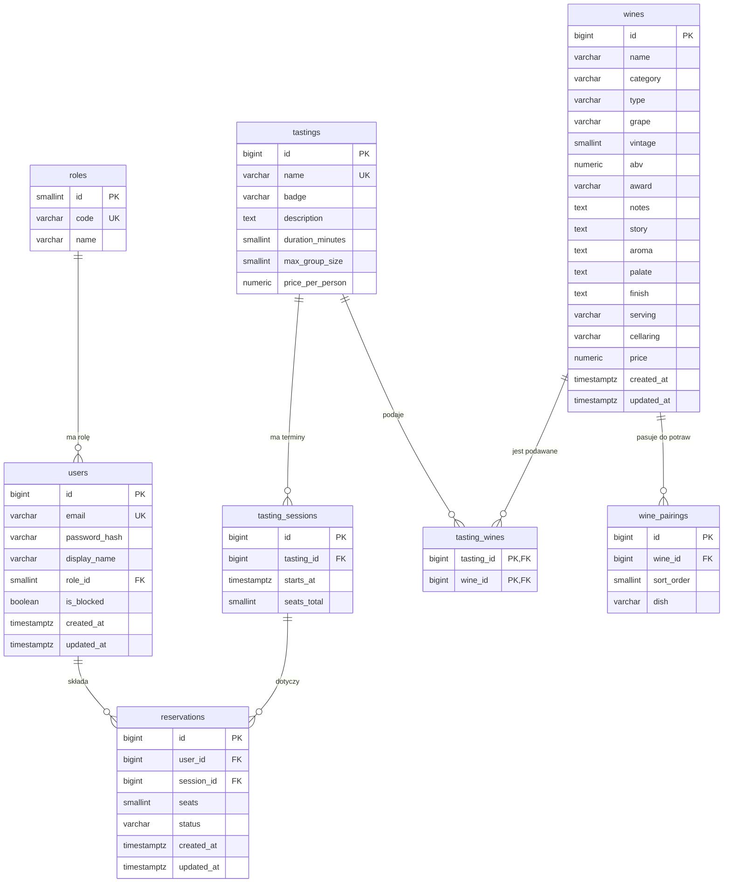

# VinoKeep

VinoKeep to aplikacja webowa dla winnic: prezentuje ofertę (wina, degustacje, historię posiadłości) i będzie służyć do zarządzania winnicą. Projekt na kurs „Wstęp do Projektowania Aplikacji Internetowych” (WdPAI), budowany w PHP w architekturze MVC. Domyślna treść jest przygotowana dla winnicy Corvo Bianco, ale wszystkie napisy są wydzielone do konfiguracji, żeby platforma działała dla dowolnej winnicy.

## Funkcje

| Obszar | Co robi | Status |
|---|---|---|
| Strona startowa (`/`) | Hero, statystyki winnicy, przyciski do głównych sekcji | gotowe |
| Nasze wina (`/wines`) | Katalog win w siatce kart, filtr rodzaju (`?type=`) i rozbudowana strona szczegółów wina (`/wines/{id}`: opis, notatki degustacyjne, potrawy, temperatura podawania, leżakowanie, karta z ceną i sekcja „Zobacz także”) | gotowe (dane z PostgreSQL) |
| Degustacje (`/tastings`) | Oferty degustacji z winami i najbliższymi terminami (wolne miejsca liczone z rezerwacji), kroki rezerwacji | gotowe, dane z bazy (bez rezerwacji) |
| O winnicy (`/about`) | Historia, fakty i cechy posiadłości | gotowe |
| Logowanie (`/login`) | Uwierzytelnianie hasłem (`password_verify`), sesja z nowym id po zalogowaniu, jeden ogólny komunikat przy złym adresie lub haśle, token CSRF | gotowe |
| Rejestracja (`/register`) | Walidacja e-maila i hasła (długość, litera, cyfra, znak specjalny, powtórzenie), zapis konta gościa ze skrótem hasła (`password_hash`), obsługa zajętego adresu | gotowe |
| Wylogowanie (`POST /logout`) | Czyści sesję, wygasza ciasteczko i niszczy sesję; wymaga tokenu CSRF | gotowe |
| Konto (`/account`) | Dane zalogowanego użytkownika, jego rola i uprawnienia; bez logowania 401 | gotowe |
| Zarządzanie winami (`/wines/new`, `/wines/{id}/edit`) | Formularze dodawania i edycji z walidacją, usuwanie z potwierdzeniem; piwniczy dodaje i edytuje, administrator i właściciel dodatkowo usuwają | gotowe |
| Panel użytkowników (`/admin/users`) | Lista kont pobierana przez Fetch API (`GET /api/users`), blokowanie i odblokowywanie (`PATCH`), usuwanie (`DELETE`) oraz, dla właściciela, nadawanie roli administratora; stany wczytywania, pustej listy i błędów | gotowe (Lab 11) |
| Teksty serwisu | Wszystkie napisy i nazwa marki w `config/content.php` | gotowe |
| Motyw jasny/ciemny | Przełącznik w nagłówku: tryb systemowy, jasny lub ciemny, wybór zapamiętany w przeglądarce | gotowe |
| Dostępność (WCAG) | Semantyczne znaczniki, widoczny fokus, kontrast sprawdzony w obu motywach narzędziem axe | częściowo, pełny audyt planowany w przyszłości |
| Baza PostgreSQL | Schemat z 8 tabelami (użytkownicy, role, wina, degustacje, rezerwacje), indeksy, dane demonstracyjne i warstwa danych przez PDO (encje, repozytoria, DTO, Value Object) | gotowe, aplikacja czyta z bazy wina, degustacje i konta, a zapisuje konta oraz wina |
| Role użytkowników | `GUEST`, `CELLAR_MASTER`, `ADMIN` (może być ich wielu) i `WINERY_OWNER` (jeden, wymuszone indeksem w bazie) z uprawnieniami sprawdzanymi po stronie serwera (401 bez logowania, 403 przy niewłaściwej roli) | gotowe |
| Rezerwacje, upload, edycja treści | Rezerwacje degustacji, zdjęcia, edycja treści w panelu | planowane w przyszłości |

## Tech stack

| Warstwa | Technologie |
|---|---|
| Backend | PHP 8.3 (własny MVC, autoloading PSR-4 przez Composer) |
| Serwer HTTP | Nginx + PHP-FPM |
| Baza danych | PostgreSQL (kontener `db`), dostęp z PHP przez PDO i sterownik `pdo_pgsql` |
| Frontend | HTML (widoki PHP), jeden plik CSS (zmienne CSS, Flexbox, Grid, mobile-first), JavaScript bez bibliotek (przełącznik motywu, walidacja formularzy, Fetch API w panelu użytkowników) |
| Konteneryzacja | Docker Compose |
| Narzędzia | Mailpit (podgląd maili), pgAdmin (zarządzanie bazą) |

## Szybki start

```bash
git clone https://github.com/LMrosz/WdPAI.git
cd my-app
cp .env.example .env
docker compose up --build -d
```

| Usługa | Adres |
|---|---|
| Aplikacja | http://localhost:8080 |
| Mailpit | http://localhost:8025 |
| pgAdmin | http://localhost:5050 |

Porty i dane dostępowe są w pliku `.env`, który powstaje z wzoru `.env.example` (sam `.env` jest w `.gitignore`): `POSTGRES_DB`, `POSTGRES_USER`, `POSTGRES_PASSWORD`, `POSTGRES_PORT`, `MAILPIT_PORT`, `PGADMIN_PORT`, `PGADMIN_DEFAULT_EMAIL` i `PGADMIN_DEFAULT_PASSWORD`. Bez pliku `.env` compose używa tych samych wartości domyślnych. Zatrzymanie: `docker compose down`.

Przy pierwszym starcie z pustym wolumenem bazy tabele i dane demonstracyjne tworzą się same. Jeśli wolumen `pg-data` już istnieje, trzeba załadować schemat ręcznie (patrz „Baza danych”). Po aktualizacji z wcześniejszego laboratorium wystarczy dopisać do działającej bazy migrację z Lab 11:

```bash
docker compose exec db psql -U app -d app -v ON_ERROR_STOP=1 -f /docker-entrypoint-initdb.d/04-user-administration.sql
```

## Baza danych (PostgreSQL)

Wina są przechowywane w PostgreSQL. Połączenie PDO tworzy w jednym miejscu klasa `App\Database` (konfiguracja ze zmiennych środowiskowych w `config/database.php`), a cały SQL jest w repozytoriach z `App\Repository` (osobno wina, degustacje i użytkownicy). Dane opuszczają repozytorium jako obiekty z `App\Model`, opisane w sekcji „Warstwa danych”.

### Model relacyjny



| Tabela | Do czego służy | Najważniejsze reguły |
|---|---|---|
| `roles` | Role użytkowników (`GUEST`, `CELLAR_MASTER`, `ADMIN`, `WINERY_OWNER`) | unikalny `code` |
| `users` | Konta; hasło tylko jako skrót z `password_hash()`, `is_blocked` zamyka logowanie | unikalny e-mail zapisany małymi literami, rola wymagana, tylko jedno konto z rolą `WINERY_OWNER` (częściowy indeks `users_single_owner_idx`) |
| `wines` | Katalog win; cena to kwota w PLN, a napis „165 zł” składa aplikacja | `category` tylko `red`, `white`, `rose`, `sparkling`; cena od 0; moc alkoholu w zakresie 0–25; to samo wino i rocznik nie mogą się powtórzyć |
| `wine_pairings` | Potrawy pasujące do wina (relacja 1:N) | kolejność w `sort_order`, usunięcie wina usuwa jego potrawy |
| `tastings` | Rodzaje degustacji z oferty | unikalna nazwa, czas, liczba osób i cena dodatnie |
| `tasting_wines` | Wina podawane na degustacji (relacja M:N) | klucz główny złożony z obu kluczy obcych |
| `tasting_sessions` | Terminy degustacji z liczbą miejsc | jeden termin na degustację i godzinę |
| `reservations` | Rezerwacje gości na terminy | 1–12 miejsc, status `confirmed` lub `cancelled`, jedna rezerwacja użytkownika na termin |

Aplikacja czyta dziś `wines`, `wine_pairings`, `tastings`, `tasting_wines` i `tasting_sessions`, a `users` i `roles` ma w repozytorium użytkowników (jeszcze bez logowania). `reservations` służy na razie tylko do liczenia wolnych miejsc w terminach. Każdy klucz obcy ma jawną akcję `ON DELETE` i `ON UPDATE`: potrawy i powiązania degustacji znikają razem z rodzicem (`CASCADE`), a rola i termin z rezerwacjami nie mogą zostać usunięte (`RESTRICT`). Limit miejsc w terminie nie da się zapisać w `CHECK`, więc ma go pilnować transakcja w aplikacji.

Indeksy poza kluczami głównymi i ograniczeniami `UNIQUE` (PostgreSQL nie tworzy ich dla kluczy obcych sam): `wines (category)` dla filtra `?type=`, `users (role_id)`, `tasting_wines (wine_id)`, `tasting_sessions (starts_at)`, `reservations (user_id, created_at DESC)` oraz indeks częściowy `reservations (session_id) WHERE status = 'confirmed'`.

### Skrypty SQL

| Plik | Zawartość |
|---|---|
| `database/01-schema.sql` | tabele, klucze i ograniczenia |
| `database/02-indexes.sql` | indeksy |
| `database/03-seed.sql` | dane demonstracyjne: 3 role, 3 konta, 10 win z potrawami, 3 degustacje z terminami i 2 rezerwacje |
| `database/04-user-administration.sql` | Lab 11: rola `ADMIN`, kolumna `users.is_blocked`, indeks jednego właściciela i konto demonstracyjne administratora; można go uruchomić ponownie bez szkody |

Katalog `database/` jest zamontowany w kontenerze `db` jako `/docker-entrypoint-initdb.d`. PostgreSQL wykonuje te pliki **tylko raz, przy pierwszym starcie z pustym wolumenem** `pg-data`, w kolejności nazw. Jeśli wolumen już istnieje (baza była uruchomiona wcześniej), załaduj schemat ręcznie. Ścieżki wskazują plik wewnątrz kontenera, więc polecenia działają w każdej powłoce:

```bash
docker compose exec db psql -U app -d app -v ON_ERROR_STOP=1 \
  -f /docker-entrypoint-initdb.d/01-schema.sql \
  -f /docker-entrypoint-initdb.d/02-indexes.sql \
  -f /docker-entrypoint-initdb.d/03-seed.sql
```

Skrypty 01–03 nie są powtarzalne (tworzą tabele), a `04` jest. Aby zacząć od zera i skasować dane bazy: `docker compose down -v`, a potem `docker compose up -d`.

### Warstwa danych (Lab 8)

Wynik zapytania (tablica z `FETCH_ASSOC`) zamieniamy ręcznie na obiekt w repozytorium, więc widoki i kontrolery nie znają nazw kolumn. Mapowanie jest ręczne, a nie przez `FETCH_CLASS`, bo `FETCH_CLASS` omija konstruktor i wymaga publicznych, modyfikowalnych pól, a nasze obiekty są niezmienne (`readonly`) i mają typy w konstruktorze.

| Rodzaj | Klasy | Rola |
|--------|-------|------|
| Entity (ma tożsamość: `id`) | `Wine`, `User`, `Tasting`, `TastingSession` | wiersz z bazy jako obiekt z typami i drobną logiką (`Tasting::durationLabel()`, `TastingSession::seatsFree()`, `User::verifyPassword()`) |
| DTO (pojemnik bez logiki) | `App\Dto\WineData`, `TastedWine` | `WineData` niesie dane wina do zapisu (nowe wino nie ma jeszcze `id`), `TastedWine` to skrót wina na liście degustacji |
| Value Object (liczy się wartość) | `App\Model\Email`, `Role` (enum) | `Email` jest niezmienny, normalizuje adres do małych liter i waliduje się w konstruktorze, więc każdy obiekt jest poprawny |

Repozytoria (interfejs plus implementacja dla PostgreSQL):

| Interfejs | Implementacja | Zapytania |
|-----------|---------------|-----------|
| `WineRepositoryInterface` | `PostgresWineRepository` (oraz `ContentWineRepository` z pliku) | odczyt win (`findAll`, `findById`, `findRelated`) |
| `WineWriterInterface` | `PostgresWineRepository` | `create(WineData)`, `update(id, WineData)` i `delete(id)` w transakcjach, `findDataById` do formularza edycji; duplikat nazwy i rocznika rzuca `DuplicateWineException` |
| `UserRepositoryInterface` | `PostgresUserRepository` | `users JOIN roles`, `create` (duplikat adresu rzuca `EmailAlreadyUsedException`), `delete` |
| `TastingRepositoryInterface` | `PostgresTastingRepository` | `tasting_wines JOIN wines` oraz `tasting_sessions LEFT JOIN reservations` z `GROUP BY` do wolnych miejsc |

Kontrolery dostają repozytorium przez konstruktor (domyślnie wersję dla PostgreSQL), więc w testach i w kolejnych laboratoriach można je podmienić. Formatowanie cen w jednym miejscu robi `App\Service\PriceFormatter`.

Skrypty pokazowe uruchamiane w kontenerze `php`:

```bash
docker compose exec php php bin/demo-repositories.php   # Email, użytkownicy z rolą, degustacje z terminami (konto demo jest od razu usuwane)
docker compose exec php php bin/demo-auth.php           # rejestracja ze skrótem hasła, logowanie, uprawnienia ról (konto demo jest od razu usuwane)
```

### Sprawdzenie połączenia i bazy

```bash
docker compose exec php php -m | grep -E 'PDO|pdo_pgsql'      # sterownik jest załadowany
docker compose exec db psql -U app -d app -c "\dt"            # lista tabel
docker compose exec db psql -U app -d app -c "\d wines"       # struktura tabeli, indeksy, ograniczenia
```

Baza odrzuca niedozwoloną kategorię, niezależnie od kodu PHP:

```bash
docker compose exec db psql -U app -d app -c "INSERT INTO wines (name, category, type, notes, price) VALUES ('Test', 'orange', 'x', 'x', 1)"
# ERROR:  new row for relation "wines" violates check constraint "wines_category_check"
```

Operacje CRUD na repozytorium pokazuje skrypt `bin/demo-wines-crud.php` (dane wina przekazuje przez DTO `WineData`). Dodane wina od razu widać na `/wines`, a odświeżenie strony ich nie usuwa, bo leżą w bazie:

```bash
docker compose exec php php bin/demo-wines-crud.php           # dodaje 3 wina w różnych kategoriach
docker compose exec php php bin/demo-wines-crud.php update    # zmienia cenę pierwszego wina demo
docker compose exec php php bin/demo-wines-crud.php cleanup   # usuwa wina demo
```

### Konfiguracja połączenia

`docker-compose.yaml` przekazuje kontenerowi `php` zmienne `DB_HOST`, `DB_PORT`, `DB_NAME`, `DB_USER` i `DB_PASSWORD` (wartości pochodzą z `POSTGRES_*` w pliku `.env`). W Dockerze host bazy to nazwa usługi `db` i port wewnętrzny `5432`; `localhost` w kontenerze oznaczałby sam kontener `php`. Port `5433` z `docker-compose.yaml` jest tylko dla klientów uruchomionych na komputerze, np. `psql` albo DBeaver. Szczegóły błędu połączenia trafiają do logu serwera, a użytkownik widzi ogólną stronę 500.

### Konta demonstracyjne

Skrypty `03-seed.sql` i `04-user-administration.sql` tworzą cztery konta (`gosc@corvo-bianco.example`, `piwniczy@corvo-bianco.example`, `admin@corvo-bianco.example`, `wlasciciel@corvo-bianco.example`) z hasłem `Winiarz-2026!`. To dane wyłącznie do lokalnego rozwoju. Można nimi zalogować się na `/login`: `gosc@` ma rolę `GUEST`, `piwniczy@` rolę `CELLAR_MASTER`, `admin@` rolę `ADMIN`, a `wlasciciel@` rolę `WINERY_OWNER`. Konta zakładane przez `/register` zawsze mają rolę `GUEST`; wyższe role nadaje się w bazie, np. `UPDATE users SET role_id = (SELECT id FROM roles WHERE code = 'CELLAR_MASTER') WHERE email = '...'`, a rolę administratora może też nadać właściciel w panelu `/admin/users`.

## Debugowanie (Xdebug)

Kontener `php` ma zainstalowany Xdebug 3 (konfiguracja w `docker/php/xdebug.ini`: tryb `debug`, port `9003`, host `host.docker.internal`). Po zmianie Dockerfile'a trzeba przebudować obraz: `docker compose up --build -d`.

Sprawdzenie, że rozszerzenie działa:

```bash
docker compose exec php php -v        # w wersji powinno być "with Xdebug v3..."
docker compose exec php php -i | grep xdebug.mode
```

Konfiguracja w VS Code (rozszerzenie **PHP Debug**, autor Xdebug). Folder `.vscode/` jest w `.gitignore`, więc plik `.vscode/launch.json` każdy tworzy u siebie:

```json
{
  "version": "0.2.0",
  "configurations": [
    {
      "name": "Listen for Xdebug (Docker)",
      "type": "php",
      "request": "launch",
      "port": 9003,
      "pathMappings": { "/app": "${workspaceFolder}" }
    }
  ]
}
```

Użycie:

1. Ustaw punkt przerwania, np. w `WineController::show` w `src/controllers/WineController.php`.
2. Uruchom konfigurację „Listen for Xdebug (Docker)” (F5).
3. Otwórz http://localhost:8080/wines/1. Wykonanie zatrzyma się na punkcie przerwania i będzie można oglądać zmienne oraz wykonywać kod krok po kroku.

W PhpStorm wystarczy w ustawieniach PHP dodać serwer `localhost:8080` z mapowaniem ścieżek katalogu projektu na `/app`, a port debuggera ustawić na `9003`. Na Linuxie `host.docker.internal` działa dzięki wpisowi `extra_hosts` w `docker-compose.yaml`. Gdy debugowanie nie jest potrzebne, w `docker/php/xdebug.ini` można ustawić `xdebug.mode = off`.

## Struktura projektu

```text
my-app/
├── bin/
│   ├── demo-auth.php        # pokaz uwierzytelniania: rejestracja, logowanie, uprawnienia ról
│   ├── demo-repositories.php # pokaz warstwy danych: użytkownicy, Value Object Email, degustacje
│   └── demo-wines-crud.php  # pokaz operacji CRUD na repozytorium win (DTO WineData)
├── config/
│   ├── content.php          # wszystkie teksty i dane marki (domyślnie Corvo Bianco)
│   └── database.php         # dane połączenia z bazą (ze zmiennych środowiskowych)
├── database/                # skrypty SQL: schemat, indeksy, dane demonstracyjne, administracja użytkownikami (04)
├── docker/                  # Dockerfile'e i konfiguracja nginx, php, db
├── public/
│   ├── index.php            # front controller, definicje tras
│   ├── css/style.css        # design system „Terroir & Heritage Luxe”, tokeny obu motywów
│   ├── js/theme.js          # przełącznik motywu jasny/ciemny/systemowy
│   ├── js/app.js            # punkt wejścia JavaScriptu (moduł ES), uruchamia moduły z js/modules/
│   ├── js/modules/          # walidacja formularzy, pokaż hasło, licznik znaków, wyszukiwarka win
│   ├── js/users.js          # panel użytkowników (Fetch API), ładowany tylko na /admin/users
│   └── views/               # widoki *.html.php (sam element <main>)
│       ├── layout.html.php  # wspólny szkielet strony, składa head, nagłówek, treść i stopkę
│       ├── error.html.php   # wspólny widok błędów 400, 401, 403, 404 i 500
│       ├── account.html.php # konto zalogowanego użytkownika
│       ├── admin-users.html.php # panel użytkowników (szkielet, listę rysuje js/users.js)
│       ├── wine-form.html.php # formularz dodawania i edycji wina
│       └── partials/        # wspólne head, header, footer, pola formularzy, pole tokenu CSRF
├── src/
│   ├── Database.php         # tworzy połączenie PDO z PostgreSQL
│   ├── Routing.php          # router
│   ├── Exception/           # HttpException i wyjątki 400, 401, 403, 404, ApiException (błędy JSON) oraz wyjątki domenowe (zajęty e-mail, duplikat wina, zablokowane konto)
│   ├── Dto/WineData.php     # DTO z danymi wina do zapisu
│   ├── Model/               # encje (Wine, User, Tasting, TastingSession), Value Object Email, enum Role i Permission, TastedWine
│   ├── Repository/          # interfejsy i implementacje dla PostgreSQL (wina, użytkownicy, degustacje) oraz ContentWineRepository (plik)
│   ├── Service/
│   │   ├── AuthService.php  # rejestracja i weryfikacja hasła
│   │   ├── PriceFormatter.php # formatowanie kwot z bazy („165 zł”)
│   │   ├── Session.php      # konfiguracja i uruchomienie sesji, logowanie i niszczenie sesji
│   │   ├── SiteContent.php  # odczyt tekstów z config/content.php
│   │   ├── UserAdminService.php # reguły panelu: kto kogo może blokować, usuwać i awansować
│   │   └── Validator.php    # walidacja danych z formularzy po stronie serwera
│   └── controllers/         # kontrolery (AppController jako baza z pomocnikami sesji i CSRF, SecurityController, AccountController, AdminController, UserApiController, WineManagementController, ErrorController)
├── docker-compose.yaml
├── composer.json
└── AGENTS.MD                # zasady pracy z asystentem AI
```

Przepływ żądania: nginx → `public/index.php` → `Routing` → kontroler → widok. Kontroler przekazuje do widoku dane, a teksty pobiera przez `$t('klucz')` z `config/content.php`. Widok zwraca tylko `<main>`, a resztę strony dokłada `layout.html.php`.

## Motyw jasny i ciemny

Wygląd obu motywów opisują zmienne CSS w `public/css/style.css`: motyw jasny to `:root`, a ciemny `html[data-theme="dark"]` z tymi samymi nazwami zmiennych. Komponenty korzystają wyłącznie ze zmiennych, więc nie ma osobnego arkusza dla ciemnego motywu.

- Mały skrypt w `partials/head.html.php` ustawia motyw przed załadowaniem CSS, żeby strona nie migała.
- Przycisk w nagłówku przełącza kolejno: systemowy (ikona monitora), jasny (słońce), ciemny (księżyc).
- Wybór jasny/ciemny jest zapisany w `localStorage` pod kluczem `theme`. W trybie systemowym nie ma zapisu i strona podąża za ustawieniem systemu.
- Zmiana motywu w jednej karcie przeglądarki od razu przenosi się do pozostałych.

## Trasy

| Metoda | Ścieżka | Opis |
|---|---|---|
| GET | `/` | Strona główna |
| GET | `/wines` | Katalog win; opcjonalny filtr `?type=red`, `white`, `rose` albo `sparkling` (inna wartość daje 400) |
| GET | `/wines/new` | Formularz nowego wina (`CELLAR_MASTER`, `WINERY_OWNER`); musi być zarejestrowana przed `/wines/{id}` |
| POST | `/wines` | Zapis nowego wina: błędy wracają do formularza (422), sukces przekierowuje na stronę wina |
| GET | `/wines/{id}` | Strona wina z opisem, notatkami degustacyjnymi i propozycjami potraw; `id` niebędące dodatnią liczbą daje 400, a nieistniejące wino 404 |
| GET | `/wines/{id}/edit` | Formularz edycji wina (`CELLAR_MASTER`, `WINERY_OWNER`) |
| POST | `/wines/{id}/edit` | Zapis zmian w winie |
| POST | `/wines/{id}/delete` | Usunięcie wina (tylko `WINERY_OWNER`) |
| GET | `/tastings` | Degustacje |
| GET | `/about` | O winnicy |
| GET | `/login` | Formularz logowania |
| POST | `/login` | Logowanie: zły token CSRF to 403, błędne pola 422, zły adres lub hasło 422 z ogólnym komunikatem, sukces przekierowuje na `/account` |
| GET | `/register` | Formularz rejestracji |
| POST | `/register` | Rejestracja: błędy i zajęty adres wracają do formularza (422), sukces przekierowuje na `/login?registered=1` |
| POST | `/logout` | Wylogowanie (token CSRF), przekierowanie na `/login?logged_out=1` |
| GET | `/account` | Konto zalogowanego użytkownika (bez logowania 401) |
| GET | `/admin/users` | Panel użytkowników (`ADMIN`, `WINERY_OWNER`); bez logowania 401, z inną rolą 403 |
| GET | `/api/users` | JSON z listą kont i flagami `canBlock`, `canDelete`, `canChangeRole` |
| DELETE | `/api/users/{id}` | Usunięcie konta (204); token w nagłówku `X-CSRF-Token` |
| PATCH | `/api/users/{id}/block` | Blokada albo odblokowanie konta, ciało `{"blocked": true}` |
| PATCH | `/api/users/{id}/role` | Zmiana roli (`GUEST`, `CELLAR_MASTER`, `ADMIN`), ciało `{"role": "ADMIN"}`; tylko `WINERY_OWNER` |

## Parametry w adresie

Trasa może mieć parametr w klamrach, np. `/wines/{id}`. Router przekazuje go do akcji kontrolera jako tekst, a format sprawdza kontroler. Dzięki temu `/wines/abc` daje 400 (zły format), a `/wines/999` 404 (poprawny format, ale nie ma takiego wina). Parametry z query string (`?type=`) kontroler też waliduje i przy nieznanej wartości rzuca `BadRequestException`.

Kontroler korzysta z `WineRepositoryInterface` (a `TastingController` z `TastingRepositoryInterface`), więc źródło win można podmienić bez zmian w jego logice. Domyślnie działa `PostgresWineRepository`, a identyfikator wina to `id` z tabeli `wines`. `ContentWineRepository` (lista z `config/content.php`, id to numer na liście) pozostaje jako druga implementacja tego samego interfejsu.

## Obsługa błędów

Router rzuca `NotFoundException`, gdy żadna trasa nie pasuje, a kontroler może rzucić `BadRequestException` (np. zły format identyfikatora), `UnauthorizedException` (akcja wymaga logowania) albo `ForbiddenException` (rola bez uprawnienia albo zły token CSRF). Front controller łapie `HttpException` i pokazuje stronę błędu z odpowiednim kodem (400, 401, 403 albo 404) przez `ErrorController`; strona 401 prowadzi do logowania. Dla adresów zaczynających się od `/api/` te same wyjątki kończą się odpowiedzią JSON `{"error": {"status", "reason", "message"}}` (`ErrorController::showJson()`), bo skrypt nie wyświetli strony HTML. Każdy inny nieoczekiwany błąd kończy się ogólną stroną 500, a szczegóły trafiają tylko do logu serwera, bez stack trace dla użytkownika. Teksty błędów są w `config/content.php` (`errors.*` dla stron, `api_errors.*` dla JSON).

## Walidacja formularzy

`App\Service\Validator` sprawdza dane po stronie serwera łańcuchem reguł (`required`, `email`, `minLength`, `maxLength`, `maxBytes`, `matches`, `letterAndDigit`, `specialCharacter`, `inList`, `integerBetween`, `decimalBetween`) i dla każdego pola zapamiętuje pierwszy błąd. Komunikaty są w `config/content.php` (`validation.*`), więc walidator nie zawiera napisów.

Formularze logowania, rejestracji i wina działają tak samo:

- `POST` jest obsługiwany w `SecurityController` (logowanie, rejestracja) i `WineManagementController` (wina), a wartości z `$_POST` czyta `AppController::postString()` (pole z tablicą, np. `email[]=x`, traktowane jest jak puste),
- przy błędzie kontroler odsyła formularz z kodem **422**, komunikatami przy polach i wpisanym e-mailem; haseł nigdy nie odsyła,
- komunikaty są powiązane z polami przez `aria-describedby` i `aria-invalid`, a nad formularzem jest podsumowanie błędów z linkami do pól,
- formularze mają `novalidate`, żeby przeglądarka nie pokazywała własnych dymków; komunikaty pochodzą z serwera, a przy włączonym JavaScripcie pokazuje je wcześniej `public/js` (sekcja „JavaScript (Lab 10)”),
- przy poprawnych danych kontroler odpowiada przekierowaniem **303** (wzorzec Post/Redirect/Get), więc odświeżenie strony nie wysyła formularza drugi raz.

Reguły pól są zapisane raz, tekstem, np. `['required', 'max_length:254']`, w stałych kontrolera (`SecurityController::REGISTER_RULES`, `WineManagementController::fieldRules()`). Serwer stosuje je przez `Validator::withRules()`, a widok wypisuje ten sam zapis w atrybucie `data-rules` pola, z którego korzysta JavaScript. Dzięki temu serwer i przeglądarka sprawdzają te same reguły i nie trzeba ich utrzymywać w dwóch miejscach.

Limity pól: e-mail do 254 znaków, hasło od 8 do 64 znaków (i najwyżej 72 bajty, bo tyle uwzględnia bcrypt), z literą, cyfrą i znakiem specjalnym. W formularzu wina liczby przyjmują przecinek lub kropkę (cena do 2 miejsc po przecinku, moc alkoholu do 1), rocznik to 1900–2100, a potrawy wpisuje się po jednej w wierszu (najwyżej 10).

## JavaScript (Lab 10)

JavaScript jest dodatkiem do działającej strony (progressive enhancement): bez niego formularze waliduje serwer, a katalog win filtrują linki rodzajów. Layout ładuje `public/js/app.js` jako moduł ES (`<script type="module">`), który wykonuje się po zbudowaniu dokumentu, tak jak skrypt z atrybutem `defer`. `app.js` tylko wywołuje moduły z `public/js/modules/`, a każdy z nich szuka własnych elementów i nic nie robi, gdy ich nie ma.

| Moduł | Co robi |
|---|---|
| `validation-rules.js` | reguły walidacji o tych samych nazwach co w `Validator` (PHP): `required`, `email`, `min_length`, `max_length`, `max_bytes`, `matches`, `letter_and_digit`, `special_character`, `in_list`, `integer_between`, `decimal_between` |
| `form-validation.js` | obsługa zdarzeń `change`, `input` i `submit` w formularzach z `data-validate`, blokada przycisku po wysłaniu |
| `field-feedback.js` | manipulacja DOM: komunikat przy polu, `aria-invalid`, `aria-describedby`, podsumowanie błędów nad formularzem |
| `password-toggle.js` | przycisk „Pokaż hasło” (`aria-pressed`) pod polami hasła |
| `char-counter.js` | licznik znaków pod polami wieloliniowymi z limitem |
| `wine-search.js` | wyszukiwarka w katalogu win: filtruje karty na bieżąco, bez wielkości liter i polskich znaków |
| `messages.js` | odczyt tekstów interfejsu przekazanych przez layout |

Jak działa walidacja w przeglądarce:

- pole jest sprawdzane po opuszczeniu zmienionego pola (`change`); gdy ma już błąd, komunikat poprawia się przy każdym znaku (`input`), a potwierdzenie hasła jest sprawdzane ponownie po zmianie hasła,
- przy wysyłaniu (`submit`) sprawdzane są wszystkie pola; przy błędach formularz nie jest wysyłany, nad nim pojawia się podsumowanie z linkami do pól, a fokus trafia na pierwsze błędne pole,
- komunikaty pochodzą z `config/content.php` (sekcje `validation`, `forms`, `js`, a w panelu użytkowników także `admin` i `roles`): layout wypisuje je jako JSON w `<script type="application/json" id="js-messages">`, więc kod JavaScript nie zawiera żadnych napisów i podąży za tłumaczeniem,
- tekst błędów trafia do strony przez `textContent`, nigdy przez `innerHTML`,
- to tylko wygoda użytkownika: serwer waliduje te same dane jeszcze raz, bo żądanie można wysłać z pominięciem JavaScriptu.

Wyszukiwarka w `/wines` jest ukryta (`hidden`), dopóki skrypt jej nie pokaże, a liczba wyników trafia do regionu `role="status"`; szuka w nazwie, rodzaju, szczepie i opisie karty, w obrębie kategorii wybranej linkiem filtra.

## Fetch API i panel użytkowników (Lab 11)

Panel `/admin/users` (`AdminController::index`) zwraca tylko szkielet strony. `public/js/users.js` (moduł ładowany tylko na tej stronie, wykonuje się po zbudowaniu dokumentu jak `defer`) pobiera listę przez `fetch('/api/users')`, rysuje wiersze i wysyła zmiany bez przeładowania strony.

- **API** (`UserApiController`): `GET /api/users`, `DELETE /api/users/{id}`, `PATCH /api/users/{id}/block`, `PATCH /api/users/{id}/role`. Router dostał metody `patch()` i `delete()`, a `AppController` pomocniki `json()`, `noContent()` (204), `jsonBody()` i `requireValidCsrfHeader()`.
- **Kody odpowiedzi:** 200 z JSON, 204 po usunięciu, 400 (zły identyfikator lub treść), 401 (brak sesji albo konto zablokowane), 403 (rola, token CSRF, konto właściciela, administrator dla nie-właściciela), 404 (brak konta), 422 (własne konto, nieprawidłowe dane).
- **Stany interfejsu:** wczytywanie, lista, pusta lista, błąd sieci (z limitem czasu 15 s) i błąd odpowiedzi API, oba z przyciskiem „Spróbuj ponownie”. Kontrolki wiersza są wyłączone na czas żądania, a po akcji fokus wraca na przycisk. Usuwanie wymaga potwierdzenia w wierszu (przycisk zamienia się w pytanie), wynik akcji czyta region `role="status"`.
- **Bezpieczeństwo:** każda akcja zaczyna się od `requirePermission()` (401 i 403), potem sprawdzany jest token z nagłówka `X-CSRF-Token`. Flagi `canBlock`, `canDelete` i `canChangeRole` w odpowiedzi tylko ukrywają przyciski, a reguły i tak sprawdza `UserAdminService` przy każdej akcji. Odpowiedzi mają `Cache-Control: no-store` i nie zawierają skrótów haseł.
- **Teksty:** wszystkie napisy panelu są w `config/content.php` (`admin`, `roles`, `api_errors`); sekcje `admin` i `roles` layout przekazuje do JS w bloku `#js-messages`.

## Uwierzytelnianie i sesje (Lab 9)

**Sesja.** `App\Service\Session::start()` konfiguruje ciasteczko sesji raz, w `public/index.php`, zanim ruszy routing: bez daty ważności (znika z zamknięciem przeglądarki), `HttpOnly` (niedostępne dla JavaScriptu), `SameSite=Lax` i `Secure` tylko przy HTTPS, żeby lokalnie po `http://localhost` sesja działała. W sesji jest tylko `user` (id, e-mail, nazwa, rola, czas logowania) i token CSRF, nigdy hasło ani jego skrót.

**Rejestracja i logowanie** (`SecurityController`, logika w `AuthService`):

- hasło zapisujemy jako `password_hash(PASSWORD_DEFAULT)`, a sprawdzamy przez `password_verify`; jawnego hasła nie ma nigdzie w bazie ani w logach,
- nowe konto zawsze dostaje rolę `GUEST`; roli nie da się podać w formularzu,
- zajęty adres kończy się komunikatem przy polu e-mail; ochrona działa także przy dwóch równoczesnych rejestracjach, bo ostateczną decyzję podejmuje `UNIQUE` w bazie (`EmailAlreadyUsedException`),
- zły adres i złe hasło dają ten sam komunikat „Nieprawidłowy e-mail lub hasło.”, a przy nieistniejącym koncie i tak liczony jest skrót, żeby czas odpowiedzi nie zdradzał, czy konto istnieje,
- po zalogowaniu `session_regenerate_id(true)` wymienia id sesji (ochrona przed session fixation), a stare id przestaje działać.

**Wylogowanie** to `POST /logout` z tokenem CSRF: czyści `$_SESSION`, wygasza ciasteczko i wywołuje `session_destroy()`. Zwykły link GET dałoby się wywołać z obcej strony i wylogować użytkownika bez jego wiedzy. Nagłówek pokazuje „Zaloguj się” albo „Moje konto” i „Wyloguj się”.

**CSRF.** Każdy formularz POST (logowanie, rejestracja, wylogowanie, wina) ma ukryte pole `csrf_token` z `bin2hex(random_bytes(32))` zapisanym w sesji. Akcja zaczyna się od `requireValidCsrf()`, które porównuje token przez `hash_equals` i przy niezgodności rzuca `ForbiddenException` (403). Po zalogowaniu token jest generowany od nowa.

**Role i uprawnienia.** Enum `Role` wie, jakie `Permission` ma każda rola:

| Rola | Uprawnienia |
|------|-------------|
| `GUEST` | przeglądanie win i degustacji |
| `CELLAR_MASTER` | dodatkowo `ManageWines`: dodawanie i edycja win |
| `ADMIN` | dodatkowo `DeleteWines` i `ManageUsers`: usuwanie win oraz panel kont (blokowanie i usuwanie użytkowników) |
| `WINERY_OWNER` | jak `ADMIN`, a dodatkowo `ManageAdmins`: nadaje i odbiera rolę administratora, blokuje i usuwa administratorów |

Akcje chronione zaczynają się od `requireLogin()`, `requireUser()` albo `requirePermission()` z `AppController`: brak sesji daje **401**, a rola bez uprawnienia **403**. `requirePermission()` czyta użytkownika z bazy, więc zmiana roli albo usunięcie konta działa od razu, bez czekania na wygaśnięcie sesji. Widoki ukrywają przyciski (Dodaj, Edytuj, Usuń) na podstawie roli z sesji, ale to tylko wygoda: o dostępie decyduje serwer, więc ręczne wpisanie adresu też kończy się 401 albo 403.

**Administratorzy i właściciel.** Właściciel winnicy ma wszystkie uprawnienia administratora, ale jest tylko jeden: częściowy indeks UNIQUE w bazie nie pozwala nadać tej roli drugiej osobie, a API nie ma operacji, która by to robiła (roli `WINERY_OWNER` nie da się nadać ani odebrać). Administratorów może być wielu: właściciel deleguje tę rolę przyciskiem w panelu (`PATCH /api/users/{id}/role`). Reguły są w jednym miejscu, `UserAdminService`: nie można blokować, usuwać ani zmieniać roli własnego konta (422), konto właściciela jest nietykalne (403), kontami administratorów zarządza tylko właściciel (403), a rolę nadaje tylko właściciel.

**Blokada konta.** `users.is_blocked` zamyka logowanie: po poprawnym haśle użytkownik dostaje 403 z osobnym komunikatem (przy złym haśle nadal ogólny, więc nie ujawnia, że konto istnieje). Blokada działa od razu także na aktywną sesję, bo `requireUser()` czyta konto z bazy i przy zablokowanym kończy sesję (401).

**Lista kontrolna bezpieczeństwa:**

| Zagrożenie | Zabezpieczenie |
|------------|----------------|
| SQL injection | prepared statements z parametrami w każdym repozytorium |
| XSS | `htmlspecialchars` w każdym widoku (`$e`, `$t`) |
| Kradzież hasła z bazy | tylko skróty `password_hash`, nigdy jawne hasło |
| Session fixation | `session_regenerate_id(true)` po zalogowaniu |
| Kradzież ciasteczka | `HttpOnly`, `SameSite=Lax`, `Secure` przy HTTPS |
| CSRF | token w każdym POST, `hash_equals`, wylogowanie przez POST |
| Enumeracja kont | jeden komunikat i stały czas przy logowaniu |
| Podniesienie uprawnień | rola nigdy z formularza, uprawnienia sprawdzane po stronie serwera (401/403) |
| CSRF w API (Fetch) | token sesji w nagłówku `X-CSRF-Token` dla `PATCH` i `DELETE` (`requireValidCsrfHeader()`), cookie `SameSite=Lax` |
| XSS w panelu | dane z API trafiają do DOM przez `textContent`, nigdy `innerHTML`; JSON z `JSON_HEX_TAG` |
| Open redirect | `redirect()` przyjmuje tylko ścieżki wewnętrzne (zaczynające się od jednego `/`) |
| Wycieki informacji | błędy techniczne tylko w logu, użytkownik widzi ogólną stronę 500 |

Nie ma jeszcze ograniczania liczby prób logowania ani limitu czasu bezczynności sesji; to możliwe usprawnienia na później.

## Zmiana tekstów i marki

Nazwa winnicy, hasło, nazwa platformy, nawigacja i teksty interfejsu są w `config/content.php`. W tekstach można używać znaczników w stylu `{site.name}`, które są podstawiane z konfiguracji. Wina i degustacje (nazwy, opisy, ceny, terminy) pochodzą z bazy, czyli z `database/03-seed.sql`. Aby przygotować serwis dla innej winnicy, trzeba podmienić oba pliki; docelowo edycję przejmie panel administratora.

## Zasady developmentu

- Osobny branch dla każdego większego zakresu prac / nowej funkcjonalności, a w nim małe, logiczne commity.
- Małe, logiczne commity (format `feat:`, `fix:`, `docs:`, `chore:`).
- Mobile-first, jeden breakpoint desktopowy (`min-width: 64rem`).
- Sekrety wyłącznie w `.env`.
- Szczegółowe zasady dla asystenta AI: `AGENTS.MD`.

## Autorzy

- Łukasz Mroszczak