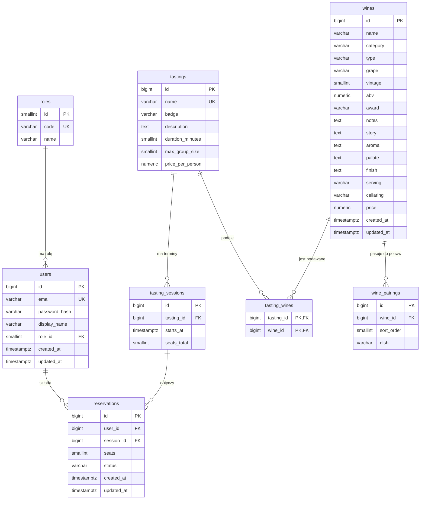

# VinoKeep

VinoKeep to aplikacja webowa dla winnic: prezentuje ofertę (wina, degustacje, historię posiadłości) i będzie służyć do zarządzania winnicą. Projekt na kurs „Wstęp do Projektowania Aplikacji Internetowych” (WdPAI), budowany w PHP w architekturze MVC. Domyślna treść jest przygotowana dla winnicy Corvo Bianco, ale wszystkie napisy są wydzielone do konfiguracji, żeby platforma działała dla dowolnej winnicy.

## Funkcje

| Obszar | Co robi | Status |
|---|---|---|
| Strona startowa (`/`) | Hero, statystyki winnicy, przyciski do głównych sekcji | gotowe |
| Nasze wina (`/wines`) | Katalog win w siatce kart, filtr rodzaju (`?type=`) i rozbudowana strona szczegółów wina (`/wines/{id}`: opis, notatki degustacyjne, potrawy, temperatura podawania, leżakowanie, karta z ceną i sekcja „Zobacz także”) | gotowe (dane z PostgreSQL) |
| Degustacje (`/tastings`) | Oferty degustacji z winami i najbliższymi terminami (wolne miejsca liczone z rezerwacji), kroki rezerwacji | gotowe, dane z bazy (bez rezerwacji) |
| O winnicy (`/about`) | Historia, fakty i cechy posiadłości | gotowe |
| Logowanie (`/login`) | Formularz z walidacją po stronie serwera (błędy przy polach, kod 422, wpisany e-mail zostaje), przekierowanie na `/` po poprawnym wysłaniu | tymczasowo, bez uwierzytelniania |
| Rejestracja (`/register`) | Formularz z walidacją e-maila i hasła (długość, litera, cyfra, znak specjalny, powtórzenie), przekierowanie na `/login` po poprawnym wysłaniu | tymczasowo, konto nie jest jeszcze zapisywane |
| Teksty serwisu | Wszystkie napisy i nazwa marki w `config/content.php` | gotowe |
| Motyw jasny/ciemny | Przełącznik w nagłówku: tryb systemowy, jasny lub ciemny, wybór zapamiętany w przeglądarce | gotowe |
| Dostępność (WCAG) | Semantyczne znaczniki, widoczny fokus, kontrast sprawdzony w obu motywach narzędziem axe | częściowo, pełny audyt planowany w przyszłości |
| Baza PostgreSQL | Schemat z 8 tabelami (użytkownicy, role, wina, degustacje, rezerwacje), indeksy, dane demonstracyjne i warstwa danych przez PDO (encje, repozytoria, DTO, Value Object) | gotowe, aplikacja czyta z bazy wina i degustacje, a konta i rezerwacje czekają na logowanie |
| Role użytkowników, rezerwacje, upload, panel admina | Prawdziwe logowanie, rezerwacje, edycja treści | planowane w przyszłości |

## Tech stack

| Warstwa | Technologie |
|---|---|
| Backend | PHP 8.3 (własny MVC, autoloading PSR-4 przez Composer) |
| Serwer HTTP | Nginx + PHP-FPM |
| Baza danych | PostgreSQL (kontener `db`), dostęp z PHP przez PDO i sterownik `pdo_pgsql` |
| Frontend | HTML (widoki PHP), jeden plik CSS (zmienne CSS, Flexbox, Grid, mobile-first), JavaScript bez bibliotek (przełącznik motywu) |
| Konteneryzacja | Docker Compose |
| Narzędzia | Mailpit (podgląd maili), pgAdmin (zarządzanie bazą) |

## Szybki start

```bash
git clone https://github.com/LMrosz/WdPAI.git
cd my-app
docker compose up --build -d
```

| Usługa | Adres |
|---|---|
| Aplikacja | http://localhost:8080 |
| Mailpit | http://localhost:8025 |
| pgAdmin | http://localhost:5050 |

Porty i dane dostępowe bazy można zmienić zmiennymi środowiskowymi (np. w pliku `.env`): `POSTGRES_PORT`, `POSTGRES_DB`, `POSTGRES_USER`, `POSTGRES_PASSWORD`, `MAILPIT_PORT`, `PGADMIN_PORT`. Zatrzymanie: `docker compose down`.

Przy pierwszym starcie z pustym wolumenem bazy tabele i dane demonstracyjne tworzą się same. Jeśli wolumen `pg-data` już istnieje, trzeba załadować schemat ręcznie (patrz „Baza danych”).

## Baza danych (PostgreSQL)

Wina są przechowywane w PostgreSQL. Połączenie PDO tworzy w jednym miejscu klasa `App\Database` (konfiguracja ze zmiennych środowiskowych w `config/database.php`), a cały SQL jest w repozytoriach z `App\Repository` (osobno wina, degustacje i użytkownicy). Dane opuszczają repozytorium jako obiekty z `App\Model`, opisane w sekcji „Warstwa danych”.

### Model relacyjny



| Tabela | Do czego służy | Najważniejsze reguły |
|---|---|---|
| `roles` | Role użytkowników (`GUEST`, `CELLAR_MASTER`, `WINERY_OWNER`) | unikalny `code` |
| `users` | Konta; hasło tylko jako skrót z `password_hash()` | unikalny e-mail zapisany małymi literami, rola wymagana |
| `wines` | Katalog win; cena to kwota w PLN, a napis „165 zł” składa aplikacja | `category` tylko `red`, `white`, `rose`, `sparkling`; cena od 0; moc alkoholu w zakresie 0–25; to samo wino i rocznik nie mogą się powtórzyć |
| `wine_pairings` | Potrawy pasujące do wina (relacja 1:N) | kolejność w `sort_order`, usunięcie wina usuwa jego potrawy |
| `tastings` | Rodzaje degustacji z oferty | unikalna nazwa, czas, liczba osób i cena dodatnie |
| `tasting_wines` | Wina podawane na degustacji (relacja M:N) | klucz główny złożony z obu kluczy obcych |
| `tasting_sessions` | Terminy degustacji z liczbą miejsc | jeden termin na degustację i godzinę |
| `reservations` | Rezerwacje gości na terminy | 1–12 miejsc, status `confirmed` lub `cancelled`, jedna rezerwacja użytkownika na termin |

Aplikacja czyta dziś `wines`, `wine_pairings`, `tastings`, `tasting_wines` i `tasting_sessions`, a `users` i `roles` ma w repozytorium użytkowników (jeszcze bez logowania). `reservations` służy na razie tylko do liczenia wolnych miejsc w terminach. Każdy klucz obcy ma jawną akcję `ON DELETE` i `ON UPDATE`: potrawy i powiązania degustacji znikają razem z rodzicem (`CASCADE`), a rola i termin z rezerwacjami nie mogą zostać usunięte (`RESTRICT`). Limit miejsc w terminie nie da się zapisać w `CHECK`, więc ma go pilnować transakcja w aplikacji.

Indeksy poza kluczami głównymi i ograniczeniami `UNIQUE` (PostgreSQL nie tworzy ich dla kluczy obcych sam): `wines (category)` dla filtra `?type=`, `users (role_id)`, `tasting_wines (wine_id)`, `tasting_sessions (starts_at)`, `reservations (user_id, created_at DESC)` oraz indeks częściowy `reservations (session_id) WHERE status = 'confirmed'`.

### Skrypty SQL

| Plik | Zawartość |
|---|---|
| `database/01-schema.sql` | tabele, klucze i ograniczenia |
| `database/02-indexes.sql` | indeksy |
| `database/03-seed.sql` | dane demonstracyjne: 3 role, 3 konta, 10 win z potrawami, 3 degustacje z terminami i 2 rezerwacje |

Katalog `database/` jest zamontowany w kontenerze `db` jako `/docker-entrypoint-initdb.d`. PostgreSQL wykonuje te pliki **tylko raz, przy pierwszym starcie z pustym wolumenem** `pg-data`, w kolejności nazw. Jeśli wolumen już istnieje (baza była uruchomiona wcześniej), załaduj schemat ręcznie. Ścieżki wskazują plik wewnątrz kontenera, więc polecenia działają w każdej powłoce:

```bash
docker compose exec db psql -U app -d app -v ON_ERROR_STOP=1 \
  -f /docker-entrypoint-initdb.d/01-schema.sql \
  -f /docker-entrypoint-initdb.d/02-indexes.sql \
  -f /docker-entrypoint-initdb.d/03-seed.sql
```

Skrypty nie są powtarzalne (tworzą tabele). Aby zacząć od zera i skasować dane bazy: `docker compose down -v`, a potem `docker compose up -d`.

### Warstwa danych (Lab 8)

Wynik zapytania (tablica z `FETCH_ASSOC`) zamieniamy ręcznie na obiekt w repozytorium, więc widoki i kontrolery nie znają nazw kolumn. Mapowanie jest ręczne, a nie przez `FETCH_CLASS`, bo `FETCH_CLASS` omija konstruktor i wymaga publicznych, modyfikowalnych pól, a nasze obiekty są niezmienne (`readonly`) i mają typy w konstruktorze.

| Rodzaj | Klasy | Rola |
|--------|-------|------|
| Entity (ma tożsamość: `id`) | `Wine`, `User`, `Tasting`, `TastingSession` | wiersz z bazy jako obiekt z typami i drobną logiką (`Tasting::durationLabel()`, `TastingSession::seatsFree()`, `User::verifyPassword()`) |
| DTO (pojemnik bez logiki) | `App\Dto\WineData`, `TastedWine` | `WineData` niesie dane wina do zapisu (nowe wino nie ma jeszcze `id`), `TastedWine` to skrót wina na liście degustacji |
| Value Object (liczy się wartość) | `App\Model\Email`, `Role` (enum) | `Email` jest niezmienny, normalizuje adres do małych liter i waliduje się w konstruktorze, więc każdy obiekt jest poprawny |

Repozytoria (interfejs plus implementacja dla PostgreSQL):

| Interfejs | Implementacja | Zapytania |
|-----------|---------------|-----------|
| `WineRepositoryInterface` | `PostgresWineRepository` (oraz `ContentWineRepository` z pliku) | odczyt win, `create(WineData)`, `update(id, WineData)` i `delete(id)` w transakcjach |
| `UserRepositoryInterface` | `PostgresUserRepository` | `users JOIN roles`, `create` (duplikat adresu rzuca `EmailAlreadyUsedException`), `delete` |
| `TastingRepositoryInterface` | `PostgresTastingRepository` | `tasting_wines JOIN wines` oraz `tasting_sessions LEFT JOIN reservations` z `GROUP BY` do wolnych miejsc |

Kontrolery dostają repozytorium przez konstruktor (domyślnie wersję dla PostgreSQL), więc w testach i w kolejnych laboratoriach można je podmienić. Formatowanie cen w jednym miejscu robi `App\Service\PriceFormatter`.

Skrypty pokazowe uruchamiane w kontenerze `php`:

```bash
docker compose exec php php bin/demo-repositories.php   # Email, użytkownicy z rolą, degustacje z terminami (konto demo jest od razu usuwane)
```

### Sprawdzenie połączenia i bazy

```bash
docker compose exec php php -m | grep -E 'PDO|pdo_pgsql'      # sterownik jest załadowany
docker compose exec db psql -U app -d app -c "\dt"            # lista tabel
docker compose exec db psql -U app -d app -c "\d wines"       # struktura tabeli, indeksy, ograniczenia
```

Baza odrzuca niedozwoloną kategorię, niezależnie od kodu PHP:

```bash
docker compose exec db psql -U app -d app -c "INSERT INTO wines (name, category, type, notes, price) VALUES ('Test', 'orange', 'x', 'x', 1)"
# ERROR:  new row for relation "wines" violates check constraint "wines_category_check"
```

Operacje CRUD na repozytorium pokazuje skrypt `bin/demo-wines-crud.php` (dane wina przekazuje przez DTO `WineData`). Dodane wina od razu widać na `/wines`, a odświeżenie strony ich nie usuwa, bo leżą w bazie:

```bash
docker compose exec php php bin/demo-wines-crud.php           # dodaje 3 wina w różnych kategoriach
docker compose exec php php bin/demo-wines-crud.php update    # zmienia cenę pierwszego wina demo
docker compose exec php php bin/demo-wines-crud.php cleanup   # usuwa wina demo
```

### Konfiguracja połączenia

`docker-compose.yaml` przekazuje kontenerowi `php` zmienne `DB_HOST`, `DB_PORT`, `DB_NAME`, `DB_USER` i `DB_PASSWORD` (wartości pochodzą z `POSTGRES_*` w pliku `.env`). W Dockerze host bazy to nazwa usługi `db` i port wewnętrzny `5432`; `localhost` w kontenerze oznaczałby sam kontener `php`. Port `5433` z `docker-compose.yaml` jest tylko dla klientów uruchomionych na komputerze, np. `psql` albo DBeaver. Szczegóły błędu połączenia trafiają do logu serwera, a użytkownik widzi ogólną stronę 500.

### Konta demonstracyjne

Skrypt `03-seed.sql` tworzy trzy konta (`gosc@corvo-bianco.example`, `piwniczy@corvo-bianco.example`, `wlasciciel@corvo-bianco.example`) z hasłem `Winiarz-2026!`. To dane wyłącznie do lokalnego rozwoju; logowanie przez aplikację nie jest jeszcze podłączone.

## Debugowanie (Xdebug)

Kontener `php` ma zainstalowany Xdebug 3 (konfiguracja w `docker/php/xdebug.ini`: tryb `debug`, port `9003`, host `host.docker.internal`). Po zmianie Dockerfile'a trzeba przebudować obraz: `docker compose up --build -d`.

Sprawdzenie, że rozszerzenie działa:

```bash
docker compose exec php php -v        # w wersji powinno być "with Xdebug v3..."
docker compose exec php php -i | grep xdebug.mode
```

Konfiguracja w VS Code (rozszerzenie **PHP Debug**, autor Xdebug). Folder `.vscode/` jest w `.gitignore`, więc plik `.vscode/launch.json` każdy tworzy u siebie:

```json
{
  "version": "0.2.0",
  "configurations": [
    {
      "name": "Listen for Xdebug (Docker)",
      "type": "php",
      "request": "launch",
      "port": 9003,
      "pathMappings": { "/app": "${workspaceFolder}" }
    }
  ]
}
```

Użycie:

1. Ustaw punkt przerwania, np. w `WineController::show` w `src/controllers/WineController.php`.
2. Uruchom konfigurację „Listen for Xdebug (Docker)” (F5).
3. Otwórz http://localhost:8080/wines/1. Wykonanie zatrzyma się na punkcie przerwania i będzie można oglądać zmienne oraz wykonywać kod krok po kroku.

W PhpStorm wystarczy w ustawieniach PHP dodać serwer `localhost:8080` z mapowaniem ścieżek katalogu projektu na `/app`, a port debuggera ustawić na `9003`. Na Linuxie `host.docker.internal` działa dzięki wpisowi `extra_hosts` w `docker-compose.yaml`. Gdy debugowanie nie jest potrzebne, w `docker/php/xdebug.ini` można ustawić `xdebug.mode = off`.

## Struktura projektu

```text
my-app/
├── bin/
│   ├── demo-repositories.php # pokaz warstwy danych: użytkownicy, Value Object Email, degustacje
│   └── demo-wines-crud.php  # pokaz operacji CRUD na repozytorium win (DTO WineData)
├── config/
│   ├── content.php          # wszystkie teksty i dane marki (domyślnie Corvo Bianco)
│   └── database.php         # dane połączenia z bazą (ze zmiennych środowiskowych)
├── database/                # skrypty SQL: schemat, indeksy, dane demonstracyjne
├── docker/                  # Dockerfile'e i konfiguracja nginx, php, db
├── public/
│   ├── index.php            # front controller, definicje tras
│   ├── css/style.css        # design system „Terroir & Heritage Luxe”, tokeny obu motywów
│   ├── js/theme.js          # przełącznik motywu jasny/ciemny/systemowy
│   └── views/               # widoki *.html.php (sam element <main>)
│       ├── layout.html.php  # wspólny szkielet strony, składa head, nagłówek, treść i stopkę
│       ├── error.html.php   # wspólny widok błędów 400, 404 i 500
│       └── partials/        # wspólne head, header, footer
├── src/
│   ├── Database.php         # tworzy połączenie PDO z PostgreSQL
│   ├── Routing.php          # router
│   ├── Exception/           # HttpException i wyjątki 400 oraz 404
│   ├── Dto/WineData.php     # DTO z danymi wina do zapisu
│   ├── Model/               # encje (Wine, User, Tasting, TastingSession), Value Object Email, enum Role, TastedWine
│   ├── Repository/          # interfejsy i implementacje dla PostgreSQL (wina, użytkownicy, degustacje) oraz ContentWineRepository (plik)
│   ├── Service/
│   │   ├── PriceFormatter.php # formatowanie kwot z bazy („165 zł”)
│   │   ├── SiteContent.php  # odczyt tekstów z config/content.php
│   │   └── Validator.php    # walidacja danych z formularzy po stronie serwera
│   └── controllers/         # kontrolery (AppController jako baza, ErrorController dla stron błędów)
├── docker-compose.yaml
├── composer.json
└── AGENTS.MD                # zasady pracy z asystentem AI
```

Przepływ żądania: nginx → `public/index.php` → `Routing` → kontroler → widok. Kontroler przekazuje do widoku dane, a teksty pobiera przez `$t('klucz')` z `config/content.php`. Widok zwraca tylko `<main>`, a resztę strony dokłada `layout.html.php`.

## Motyw jasny i ciemny

Wygląd obu motywów opisują zmienne CSS w `public/css/style.css`: motyw jasny to `:root`, a ciemny `html[data-theme="dark"]` z tymi samymi nazwami zmiennych. Komponenty korzystają wyłącznie ze zmiennych, więc nie ma osobnego arkusza dla ciemnego motywu.

- Mały skrypt w `partials/head.html.php` ustawia motyw przed załadowaniem CSS, żeby strona nie migała.
- Przycisk w nagłówku przełącza kolejno: systemowy (ikona monitora), jasny (słońce), ciemny (księżyc).
- Wybór jasny/ciemny jest zapisany w `localStorage` pod kluczem `theme`. W trybie systemowym nie ma zapisu i strona podąża za ustawieniem systemu.
- Zmiana motywu w jednej karcie przeglądarki od razu przenosi się do pozostałych.

## Trasy

| Metoda | Ścieżka | Opis |
|---|---|---|
| GET | `/` | Strona główna |
| GET | `/wines` | Katalog win; opcjonalny filtr `?type=red`, `white`, `rose` albo `sparkling` (inna wartość daje 400) |
| GET | `/wines/{id}` | Strona wina z opisem, notatkami degustacyjnymi i propozycjami potraw; `id` niebędące dodatnią liczbą daje 400, a nieistniejące wino 404 |
| GET | `/tastings` | Degustacje |
| GET | `/about` | O winnicy |
| GET | `/login` | Formularz logowania |
| POST | `/login` | Obsługa formularza: błędy wracają do formularza (422), poprawne dane przekierowują na `/` (na razie bez uwierzytelniania) |
| GET | `/register` | Formularz rejestracji |
| POST | `/register` | Obsługa formularza: błędy wracają do formularza (422), poprawne dane przekierowują na `/login?registered=1` (na razie bez zapisu konta) |

## Parametry w adresie

Trasa może mieć parametr w klamrach, np. `/wines/{id}`. Router przekazuje go do akcji kontrolera jako tekst, a format sprawdza kontroler. Dzięki temu `/wines/abc` daje 400 (zły format), a `/wines/999` 404 (poprawny format, ale nie ma takiego wina). Parametry z query string (`?type=`) kontroler też waliduje i przy nieznanej wartości rzuca `BadRequestException`.

Kontroler korzysta z `WineRepositoryInterface` (a `TastingController` z `TastingRepositoryInterface`), więc źródło win można podmienić bez zmian w jego logice. Domyślnie działa `PostgresWineRepository`, a identyfikator wina to `id` z tabeli `wines`. `ContentWineRepository` (lista z `config/content.php`, id to numer na liście) pozostaje jako druga implementacja tego samego interfejsu.

## Obsługa błędów

Router rzuca `NotFoundException`, gdy żadna trasa nie pasuje, a kontroler może rzucić `BadRequestException`, gdy żądanie jest błędne (np. zły format identyfikatora). Front controller łapie `HttpException` i pokazuje stronę błędu z odpowiednim kodem (400 albo 404) przez `ErrorController`. Każdy inny nieoczekiwany błąd kończy się ogólną stroną 500, a szczegóły trafiają tylko do logu serwera, bez stack trace dla użytkownika. Teksty błędów są w `config/content.php` (`errors.*`).

## Walidacja formularzy

`App\Service\Validator` sprawdza dane po stronie serwera łańcuchem reguł (`required`, `email`, `minLength`, `maxLength`, `matches`, `letterAndDigit`, `specialCharacter`) i dla każdego pola zapamiętuje pierwszy błąd. Komunikaty są w `config/content.php` (`validation.*`), więc walidator nie zawiera napisów.

Formularze logowania i rejestracji działają tak samo:

- `POST` jest obsługiwany w `SecurityController`, a wartości z `$_POST` czyta `AppController::postString()` (pole z tablicą, np. `email[]=x`, traktowane jest jak puste),
- przy błędzie kontroler odsyła formularz z kodem **422**, komunikatami przy polach i wpisanym e-mailem; haseł nigdy nie odsyła,
- komunikaty są powiązane z polami przez `aria-describedby` i `aria-invalid`, a nad formularzem jest podsumowanie błędów z linkami do pól,
- formularze mają `novalidate`, żeby komunikaty zawsze pochodziły z serwera,
- przy poprawnych danych kontroler odpowiada przekierowaniem **303** (wzorzec Post/Redirect/Get), więc odświeżenie strony nie wysyła formularza drugi raz.

Limity pól: e-mail do 254 znaków, hasło od 8 do 64 znaków, z literą, cyfrą i znakiem specjalnym.

## Zmiana tekstów i marki

Nazwa winnicy, hasło, nazwa platformy, nawigacja i teksty interfejsu są w `config/content.php`. W tekstach można używać znaczników w stylu `{site.name}`, które są podstawiane z konfiguracji. Wina i degustacje (nazwy, opisy, ceny, terminy) pochodzą z bazy, czyli z `database/03-seed.sql`. Aby przygotować serwis dla innej winnicy, trzeba podmienić oba pliki; docelowo edycję przejmie panel administratora.

## Zasady developmentu

- Osobny branch dla każdego większego zakresu prac / nowej funkcjonalności, a w nim małe, logiczne commity.
- Małe, logiczne commity (format `feat:`, `fix:`, `docs:`, `chore:`).
- Mobile-first, jeden breakpoint desktopowy (`min-width: 64rem`).
- Sekrety wyłącznie w `.env`.
- Szczegółowe zasady dla asystenta AI: `AGENTS.MD`.

## Autorzy

- Łukasz Mroszczak